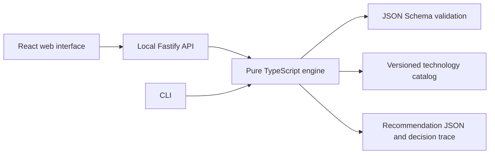

# StackSense

A local, deterministic technology stack recommendation engine for the Synergy ’26 StackSense challenge.

**Repository status: planning and contracts only. The application is not implemented yet.** This starter defines what to build, how to build it, and how to verify it. Planned commands and interfaces below are specifications, not working application features.

## Start here

1. Read [challenge interpretation](docs/CHALLENGE_BRIEF.md) and the [PRD](docs/PRD.md).
2. Implement against the [SRS](docs/SRS.md), [TRD](docs/TRD.md), and [JSON contracts](schemas/README.md).
3. Follow [UI/UX](docs/UI_UX.md), [workflows](docs/WORKFLOWS.md), and [flow diagrams](docs/flows/README.md).
4. Build the knowledge base using [research guidance](docs/KNOWLEDGE_BASE.md), then apply [decision logic](docs/DECISION_ENGINE.md) and [cost estimation](docs/COST_MODEL.md).
5. Execute the [test plan](docs/TEST_PLAN.md), [implementation roadmap](docs/ROADMAP.md), and [submission checklist](docs/SUBMISSION.md).

Full navigation: [documentation index](docs/README.md).

## Proposed application architecture



The engine selects technologies using researched rules, constraints, and scoring. No LLM selects components. MVP has no runtime LLM integration, application database, login, or paid key requirement. Technologies used to build StackSense are separate from technologies it can recommend.

## Proposed implementation layout

```text
apps/web/                 React + Vite interface
apps/api/                 Fastify local adapter
apps/cli/                 File/batch adapter
packages/engine/           Deterministic selection and explanations
packages/catalog/          Technology, compatibility, pricing, source data
packages/contracts/        Types generated from root schemas
schemas/                   Authoritative JSON Schema contracts (available now)
fixtures/public/           Original public scenarios and individual copies
outputs/                   Actual generated outputs after implementation
scripts/                   Documentation/contract checks
```

## What can run now

Python 3 is sufficient for the dependency-free documentation check:

```sh
python3 scripts/check_docs.py
```

For deeper contract validation, in a temporary virtual environment:

```sh
python3 -m venv .venv
# macOS/Linux: source .venv/bin/activate
# Windows PowerShell: .venv\Scripts\Activate.ps1
python -m pip install 'jsonschema>=4,<5'
python scripts/check_docs.py --schemas
```

Do not confuse this checker with a recommendation engine.

## Application setup contract (to implement)

Target Node.js 24 LTS and npm workspaces; verify compatibility and pin exact dependency versions and the lockfile when scaffolding. Planned judge commands:

```sh
npm ci
npm run build
npm start
npm run recommend -- --input fixtures/public/P1.json --output outputs/P1_output.json
npm run recommend:batch -- --input fixtures/public/scenarios.json --output-dir outputs
npm test
```

These npm commands do not exist yet. Replace this section with verified commands, tested prerequisites, exact versions, OS notes, screenshots, and measured setup time before submission. Default API/UI origin: `http://127.0.0.1:3000`; development UI: port 5173 with an API proxy. Final start command should serve the built UI and API from one origin.

## Challenge deliverables

- Complete locally runnable source with README and `.env.example` if applicable.
- Six genuine engine outputs, `P1_output.json` through `P6_output.json`.
- PDF report with actual screenshots, references, and AI assistance declaration.
- Google Drive submission folder under 1 GB, shared as link-viewable; submit its link on Unstop.

Deadline in the supplied brief: **15 November 2026, 23:59 IST**. Do not modify the submitted folder after that time.

## Provenance and credits

Requirements are derived from the user-supplied `StackSense_Problem_Statement.pdf`, document version 1.0, 19 pages. Public fixtures are copied from the supplied `stacksense_public_scenarios.json`. No official expected answers were supplied. See [references](docs/REFERENCES.md), [AI assistance](docs/AI_ASSISTANCE.md), and [decisions](docs/DECISIONS.md). The repository owner must review and own design choices before implementation.
