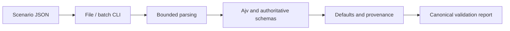

# StackSense

A local, deterministic technology stack recommendation engine for the Synergy ’26 challenge, being implemented in [five phases](docs/PHASES.md).

**Current implementation: Phase 1 — contracts, validation, normalization, and CLI.** You can validate single scenarios or batches, inspect field errors and recorded defaults, and export deterministic validation reports. Stack selection, cost estimates, API, and UI are scheduled for later phases; `valid` means structurally valid input, not a feasible architecture.

## Run Phase 1

Prerequisites: **Node.js 22.17.0 or newer within Node 22, or Node 24 LTS**, and npm. Tested here with Node 22.17.1, npm 10.9.2, macOS arm64. Windows/Linux commands use standard Node/npm APIs but have not yet been exercised on those OSes. `.nvmrc` records the tested runtime; exact dependencies are pinned in `package-lock.json`.

```sh
npm ci
npm run build
npm run validate -- --input fixtures/public/P1.json --pretty
npm run validate:batch -- --input fixtures/public/scenarios.json --output-dir validation-reports --pretty
```

Export a single report, or explicitly replace an existing report:

```sh
npm run validate -- --input fixtures/minimal.json --output validation-reports/minimal.json --pretty
npm run validate -- --input fixtures/minimal.json --output validation-reports/minimal.json --force
```

When piping stdout into another program, suppress npm's own command banner:

```sh
npm run --silent validate -- --input fixtures/minimal.json
```

After building, `node /absolute/path/to/StackSense/dist/apps/cli/src/main.js --input /absolute/path/to/scenario.json` also works from another directory. Keep the complete repository, including `schemas/`, alongside `dist/`.

## Validation report

```text
schema_version       Validation-report format version
status               valid | invalid_input
normalized_input     Input with recorded defaults, or null when invalid
assumptions[]        Every applied default and normalization interpretation
warnings[]           Preserved unknown fields and unapplied extensions
validation_errors[]  All discoverable field-level problems
```

These reports are separate from the challenge's recommendation output schema and use `_validation.json` filenames. They must not be submitted as `P1_output.json`–`P6_output.json`.

CLI exit codes: **0** valid, **2** invalid input, **1** usage/filesystem/internal error. Use `--help` for options. Input limit: 2 MiB; batch: 1–100 scenarios; nesting: 32 levels. Batch processes invalid items independently, sanitizes filenames, and writes `validation_manifest.json`. It refuses existing files unless `--force` is supplied, and refuses to overwrite the input through direct or symlink-alias paths. Writes are atomic per file, not a transaction across the whole batch. Malformed containers produce one root error on stdout.

No API keys, environment variables, LLM features, or runtime network services are needed. `--no-llm` is accepted as a no-op. Dependencies need network access during the initial install.

## Development and checks

```sh
npm run generate:types   # regenerate TS types after editing schemas
npm run check           # generated type freshness, type checking, tests
npm run build
npm run dev:validate -- --input fixtures/minimal.json --pretty
python3 scripts/check_docs.py
```

Optional deeper documentation contract checks require Python's `jsonschema` package; see [schema guidance](schemas/README.md). Current implementation verification: [Phase 1](docs/PHASE_1.md).

| Technology | Pinned version | Role |
|---|---|---|
| TypeScript | 5.9.3 | Shared contract/CLI code |
| Ajv | 8.20.0 | Standard JSON Schema validation without coercion |
| json-schema-to-typescript | 15.0.4 | Generate types from authoritative schemas |
| tsx | 4.23.15 | Source-mode development CLI |
| Vitest | 5.1.0 | Contract and real CLI subprocess tests |
| @types/node | 22.20.5 | Node runtime types |

## Current architecture and layout



```text
apps/cli/src/              Bounded file IO, safe output, CLI adapter
packages/contracts/src/    Generated types, validation, normalization, canonical JSON
schemas/                   Authoritative organiser input/output contracts
fixtures/public/           Supplied array and six individual scenarios
tests/                     Contract and actual CLI process checks
scripts/                   Type generation and documentation checks
docs/                      Product, design, research and implementation evidence
dist/                      Generated build; ignored by Git
```

Upcoming engine/API/UI boundaries: [TRD](docs/TRD.md). Selection will use researched rules, hard constraints, compatible-plan search and explainable ranking. No LLM will choose the stack.

## Planning and research

Start with [plan.md](plan.md), the [phase tracker](docs/PHASES.md), and [documentation index](docs/README.md). Product/design contracts: [PRD](docs/PRD.md), [SRS](docs/SRS.md), [UI/UX](docs/UI_UX.md), [workflows](docs/WORKFLOWS.md). Research: [annotated review](docs/RESEARCH_REVIEW.md), [sources](docs/research/sources.json), [decisions](docs/DECISIONS.md).

## Submission and credits

Final delivery still requires a completed engine, six genuine recommendation outputs, real screenshots, and the PDF report. See [submission checklist](docs/SUBMISSION.md). Deadline in the supplied brief: **15 November 2026, 23:59 IST**; do not modify the submitted Drive folder afterward.

Requirements come from user-supplied `StackSense_Problem_Statement.pdf` v1.0; public fixtures from `stacksense_public_scenarios.json`. No official expected stacks were provided. All installed third-party tools are listed above and locked in `package-lock.json`; source links/research and AI assistance are recorded in [references](docs/REFERENCES.md) and [AI assistance](docs/AI_ASSISTANCE.md). Participant review/ownership remains required by the challenge.
