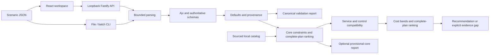

# StackSense

A local, deterministic technology stack recommendation engine for the Synergy ’26 challenge, implemented in [five phases](docs/PHASES.md).

**Release 0.5.0: all five technical phases are implemented and verified.** The CLI, local API and responsive workspace share a deterministic engine. The final report and submission ZIP are prepared; owner review and Drive/Unstop submission remain pending. Four public scenarios retain explicit evidence blockers. [Phase 5 evidence and limitations](docs/PHASE_5.md).

[Download the submission ZIP](https://github.com/oki-dokii/StackSense/blob/main/deliverables/StackSense26_SohamBanerjee.zip) · [Read the report](https://github.com/oki-dokii/StackSense/blob/main/output/pdf/Report_SohamBanerjee.pdf) · [Owner checklist](docs/SUBMISSION.md)


A [post-release repository comparison](docs/REPOSITORY_COMPARISON.md) identifies the remaining coverage and cost-calibration priorities; [backlog and acceptance gates](docs/IMPROVEMENT_BACKLOG.md). Three additional evidence-provenance checks now run in CI. The recommendation engine and report remain 0.5.0.

## Run

Prerequisites: **Node.js 22.17.0 or newer within Node 22, or Node 24 LTS**, and npm. Tested here with Node 22.17.1, npm 10.9.2, macOS arm64. Windows/Linux commands use standard Node/npm APIs but have not yet been exercised on those OSes. `.nvmrc` records the tested runtime; exact dependencies are pinned in `package-lock.json`.

```sh
npm ci
npm run build
npm start
# Open http://127.0.0.1:3000
```

Run CLI evaluations independently:

```sh
npm run recommend -- --input fixtures/public/P1.json --pretty
npm run recommend:batch -- --input fixtures/public/scenarios.json --output-dir reports --pretty
npm run validate -- --input fixtures/public/P1.json --pretty
npm run validate:batch -- --input fixtures/public/scenarios.json --output-dir validation-reports --pretty
npm run plan:core -- --input fixtures/public/P1.json --pretty
npm run plan:core:batch -- --input fixtures/public/scenarios.json --output-dir core-plans --pretty
```

Export a single report, or explicitly replace an existing report:

```sh
npm run validate -- --input fixtures/minimal.json --output validation-reports/minimal.json --pretty
npm run validate -- --input fixtures/minimal.json --output validation-reports/minimal.json --force
```

When piping stdout into another program, suppress npm's own command banner:

```sh
npm run --silent validate -- --input fixtures/minimal.json
```

After building, `node /absolute/path/to/StackSense/dist/apps/cli/src/main.js --input /absolute/path/to/scenario.json` also works from another directory. Keep the complete repository, including `schemas/`, alongside `dist/`.

## Local workspace and API

After building, `npm start` serves both UI and API at **http://127.0.0.1:3000**. Optional `STACKSENSE_PORT` changes the port. Open the workspace, complete a guided brief or import JSON, then evaluate. It supports one scenario or batches of 1–100, all four result statuses, source-backed explanation cards, costs and exact JSON exports. Editing inputs marks results stale and disables export until rerun. Drafts stay in memory; reloading discards them.

For development, run `npm run dev:api` and `npm run dev:web` in separate terminals, then open http://127.0.0.1:5173. No external recommendation requests or account/API keys are needed. See [API contract](docs/API_CLI.md), [Phase 4](docs/PHASE_4.md) and [actual screenshot](docs/evidence/phase4-report-desktop.jpg).

## Complete recommendations

`recommend` and `recommend:batch` export the organiser output format with `ok`, `ok_with_warnings`, `infeasible` or `invalid_input`. The engine checks required service compatibility/control scope for every compatible core candidate, estimates complete plans and then ranks them. No runtime network, API keys or LLM is required.

The actual public batch returns one `ok`, one `ok_with_warnings` and four `infeasible` reports, with exit **3**. Every item exports as `<scenario_id>_output.json`; the manifest is `recommendation_manifest.json`. Inspect the [committed outputs](outputs/README.md) and [Phase 3 evidence](docs/PHASE_3.md). A no-plan cost of 0–0 means **not estimated**. P1's static assets genuinely have a zero-cost hosting band under its stated limits; P3's USD 875.51–7785.95 band includes explicit sizing/pricing assumptions and a budget-risk warning.

The service catalog has 23 profiles, 45 primary-source records and two known EOL rules, alongside the 33-entry/43-source core catalog. Sources establish reviewed building blocks; configured controls, contracts, model fit and workload targets still require project-specific verification. The output is a design, not certification or a provider quote.

## Provisional core planning

The current core catalog has **33 entries and 43 official-source records**, including reviewed AWS Mumbai primary compute/PostgreSQL mappings. The engine checks platform/rendering coverage, explicit provider/deployment constraints, reviewed primary regions, database drivers and deployment compatibility, then applies a deterministic whole-plan rubric. Inspect [Phase 2](docs/PHASE_2.md) and [catalog evidence](docs/CATALOG.md) for exact coverage and limitations.

Core reports use `status: core_plan | blocked | invalid_input`, `scope: core_layers_only`, four selections where unblocked, source IDs, fit contributions, alternatives, assumptions, pending requirements and a rejection trace. They contain no fabricated USD cost estimate. Files use `_core_plan.json`.

**The public core batch currently returns one provisional plan and five blocked reports, with exit 3.** Core mode deliberately withholds complete control approval; unsupported regional mappings can also block. Final recommendation mode uses the complete service/control model. All reports still export. `core_plan` is not approval of complete feature, budget, SLA or compliance feasibility.

## Validation report

```text
schema_version       Validation-report format version
status               valid | invalid_input
normalized_input     Input with recorded defaults, or null when invalid
assumptions[]        Every applied default and normalization interpretation
warnings[]           Preserved unknown fields and unapplied extensions
validation_errors[]  All discoverable field-level problems
```

These reports are separate from the challenge's recommendation output schema and use `_validation.json` filenames. They must not be submitted as `P1_output.json`–`P6_output.json`.

CLI exit codes: **0** valid/core plan/usable recommendation, **2** invalid input, **3** blocked/infeasible plan, **1** usage/filesystem/internal error. A mixed batch prioritizes invalid input over blocked plans. Use `--help` for options. Input limit: 2 MiB; batch: 1–100 scenarios; nesting: 32 levels. Batch processes invalid items independently, sanitizes filenames, and writes `validation_manifest.json`. It refuses existing files unless `--force` is supplied, and refuses to overwrite the input through direct or symlink-alias paths. Writes are atomic per file, not a transaction across the whole batch. Malformed containers produce one root error on stdout.

No API keys, environment variables, LLM features, or runtime network services are needed. `--no-llm` is accepted as a no-op. Dependencies need network access during the initial install.

## Development and checks

```sh
npm run generate:types   # regenerate TS types after editing schemas
npm run check           # generated type freshness, type checking, tests
npm run build
npm run dev:validate -- --input fixtures/minimal.json --pretty
npm run evaluate         # author-designed unseen-style and sensitivity evidence
npm run verify:release   # verify all actual output snapshots
python3 scripts/check_docs.py
```

Optional deeper documentation contract checks require Python's `jsonschema` package; see [schema guidance](schemas/README.md). Current verification: [Phase 1](docs/PHASE_1.md), [Phase 2](docs/PHASE_2.md), [Phase 3](docs/PHASE_3.md), [Phase 4](docs/PHASE_4.md) and [Phase 5](docs/PHASE_5.md): **201 tests pass**, with a successful build. Local API/cached setup timings are recorded in Phase 5. Other-OS and recommended-workload behavior are not established by those local measurements.

| Technology | Pinned version | Role |
|---|---|---|
| TypeScript | 5.9.3 | Shared contract/CLI code |
| Ajv | 8.20.0 | Standard JSON Schema validation without coercion |
| json-schema-to-typescript | 15.0.4 | Generate types from authoritative schemas |
| tsx | 4.23.15 | Source-mode development CLI |
| Vitest | 5.1.0 | Contract and real CLI subprocess tests |
| Fastify / @fastify/static | 5.12.8 / 10.1.10 | Loopback API and bundled asset serving |
| React / react-dom | 19.3.1 | In-memory responsive workspace |
| Vite | 8.3.8 | Browser build and development proxy |
| @types/react / @types/react-dom | 19.3.0 | Browser TypeScript definitions |
| @types/node | 22.20.5 | Node runtime types |

## Current architecture and layout



```text
apps/cli/src/              Bounded file IO, safe output, CLI adapter
apps/api/src/              Loopback HTTP API and same-origin web serving
apps/web/src/              React guided brief, imports, results and exports
packages/contracts/src/    Generated types, validation, normalization, canonical JSON
packages/catalog/          Reviewed source/product/deployment catalog and integrity checks
packages/engine/src/       Features, constraints, complete-plan search, services, costs, explanations
schemas/                   Authoritative organiser input/output contracts
fixtures/public/           Supplied array and six individual scenarios
tests/                     Contract, engine, actual CLI/API and release invariant checks
evaluation/                Actual outputs, unseen-style cases and measured evidence
output/pdf/                Verified final report
deliverables/              Ready-to-review submission ZIP
scripts/                   Type generation and documentation checks
docs/                      Product, design, research and implementation evidence
dist/                      Generated build; ignored by Git
```

API/UI boundaries and remaining evidence work: [TRD](docs/TRD.md). Core selection uses local rules, hard constraints, compatible-plan search and explainable ordinal ranking. No LLM will choose the stack.

## Planning and research

Start with [plan.md](plan.md), the [phase tracker](docs/PHASES.md), and [documentation index](docs/README.md). Product/design contracts: [PRD](docs/PRD.md), [SRS](docs/SRS.md), [UI/UX](docs/UI_UX.md), [workflows](docs/WORKFLOWS.md). Research: [annotated review](docs/RESEARCH_REVIEW.md), [sources](docs/research/sources.json), [decisions](docs/DECISIONS.md).

## Submission and credits

The report, 20 genuine public/evaluation outputs, screenshot evidence, local setup/API measurements and submission ZIP are prepared. Owner review, Drive access verification and Unstop submission remain required. Broader regional/vendor evidence and cross-OS/expert validation remain limitations. See [submission checklist](docs/SUBMISSION.md). Deadline in the supplied brief: **15 November 2026, 23:59 IST**; do not modify the submitted Drive folder afterward.

Requirements come from user-supplied `StackSense_Problem_Statement.pdf` v1.0; public fixtures from `stacksense_public_scenarios.json`. No official expected stacks were provided. All installed third-party tools are listed above and locked in `package-lock.json`; source links/research and AI assistance are recorded in [references](docs/REFERENCES.md) and [AI assistance](docs/AI_ASSISTANCE.md). Participant review/ownership remains required by the challenge.
