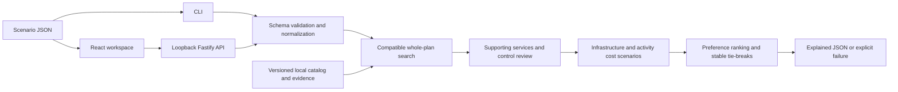
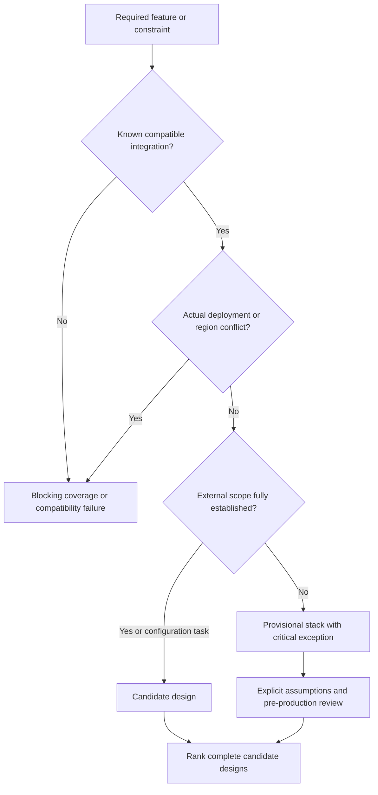
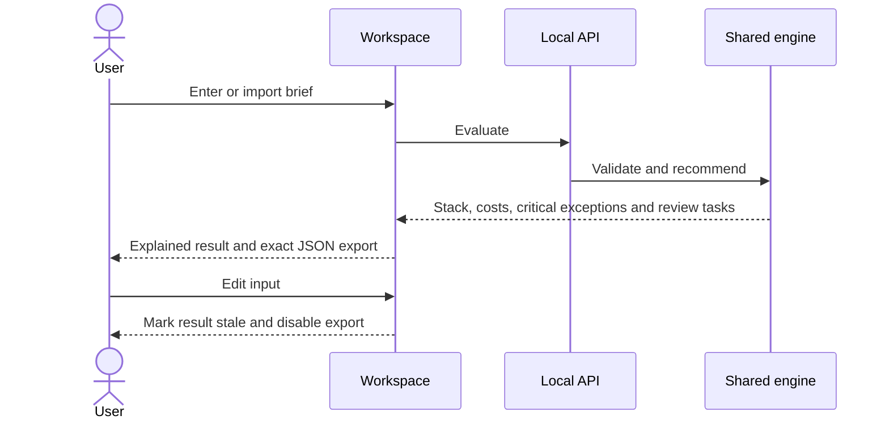
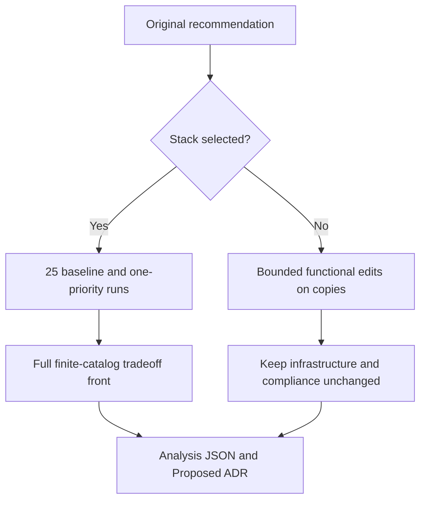
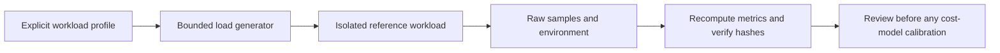

# StackSense

StackSense turns a software-project brief into an explained technology stack: frontend, backend, database, hosting and supporting services, with cost assumptions, alternatives and warnings. A deterministic local engine powers the CLI, API and browser workspace. It requires no account, API key or runtime LLM.

[Report](output/pdf/Report_SohamBanerjee.pdf) · [Submission ZIP](deliverables/StackSense26_SohamBanerjee.zip) · [Public outputs](outputs/README.md) · [Design documentation](docs/README.md)

## Quick start

Use **Node.js 22.17+ within Node 22, or Node 24**, and npm. Exact dependencies are pinned in `package-lock.json`; `.nvmrc` records the tested runtime.

```sh
git clone https://github.com/oki-dokii/StackSense.git
cd StackSense
npm ci
npm run build
npm start
```

Open **http://127.0.0.1:3000**. Load a public sample, enter a guided brief or import JSON, then select **Recommend stack**. Drafts stay in memory. Editing inputs makes results stale and disables export until rerun. The server binds to IPv4 loopback and serves both the UI and API.

Optional port: `STACKSENSE_PORT=3001 npm start` on macOS/Linux; PowerShell: `$env:STACKSENSE_PORT=3001; npm start`. For development, run `npm run dev:api` and `npm run dev:web` in separate terminals and open the printed Vite URL.

## LLM-off switch

**Use `--no-llm` to run with all LLM features disabled.** The flag is accepted as a no-op because StackSense makes no LLM calls in any mode. The same input produces the same stack with or without it.

```sh
npm run --silent recommend -- --input fixtures/public/P2.json --no-llm --pretty
npm run --silent recommend:batch -- --input fixtures/public/scenarios.json --no-llm --output-dir reports --pretty
```

The UI and API use the same deterministic engine and have no LLM configuration or paid-key dependency.

## Recommendation behavior

| Status | Meaning |
|---|---|
| `ok` | A stack is selected without non-informational warnings |
| `ok_with_warnings` | A stack is selected with explicit risks, assumptions or critical provisional exceptions |
| `infeasible` | No usable catalog design remains, for example an air-gap requiring an external payment/OTP service or a contradictory region policy |
| `invalid_input` | Field errors prevent evaluation; stack is null |

**A stack with critical warnings is provisional, not a production approval.** Known external vendors can be proposed when their end-to-end residency or contract scope is unverified. Those cases retain the requested compute/database region and explicitly disclose the external boundary that is not established. The output includes critical warnings, reduced-assurance assumptions and review tasks. It never presents an Indian vendor name, a regional host or a compliance badge as proof of end-to-end compliance.

Actual deployment/provider incompatibilities, unavailable catalog integrations, air-gap conflicts and contradictory region policies remain blocking. Budget and timeline are soft constraints: an over-budget proposal is reported plainly rather than silently dropping features.

### Public scenarios

Generated by engine/rules/services **0.8.0**, core catalog **0.4.0**. Inputs are the unchanged supplied fixtures; no official expected stacks were supplied.

| Input | Result | Selected core and main qualification |
|---|---|---|
| P1 DevFolio | `ok` | Astro / no backend / no database / Cloudflare Pages; static limits apply |
| P2 FixIt Now | `ok_with_warnings` | Next.js + React Native / Django / PostgreSQL / Cloud Run; MSG91 and Razorpay require critical external-residency review |
| P3 BoardRoom | `ok_with_warnings` | Angular / Fastify / PostgreSQL / Cloud Run; capacity, latency, availability and pricing remain planning assumptions |
| P4 QuickCredit | `ok_with_warnings` | Next.js + React Native / Fastify / PostgreSQL / ECS Fargate Mumbai; external flows and lending/KYC/ledger/disbursal scope require critical review |
| P5 PeopleDesk | `ok_with_warnings` | React / ASP.NET Core / PostgreSQL / Azure ASE Central India; direct existing Entra federation, critical tenant-geography review, separate SQL Server reuse review |
| P6 KhetSurvey | `ok_with_warnings` | React Native / Django / PostgreSQL / Cloud Run; offline persistence/sync and critically qualified MSG91 phone delivery |

The public batch exits **0** and exports all six reports: one `ok`, five `ok_with_warnings`. Critical warnings must still be reviewed. The explicit [air-gap conflict fixture](fixtures/airgap-conflict.json) demonstrates a genuine `infeasible` result and exit 3.

### Costs and budget fit

The headline `estimated_monthly_cost_usd` is **infrastructure and operations**, identified by `estimated_cost_scope`. Payment and SMS activity scenarios are additional: they appear in `cost_groups` and `cost_breakdown` but are excluded from the headline and infrastructure-budget scoring. Missing transaction/SMS volumes are disclosed assumptions, not known spending or free service. Activity scenarios have their own labeled sensitivity metrics.

| Input | Month-12 infrastructure USD/month |
|---|---:|
| P1 | 0–0, static bundle within stated limits |
| P2 | 367.76–1,193.62 |
| P3 | 639.32–2,648.75 |
| P4 | 1,028.89–3,882.82 |
| P5 | 686.87–858.06 |
| P6 | 187.90–552.07 |

These are order-of-magnitude bands, not provider quotes or measured production capacity. The model no longer counts peak WebSocket capacity twice. It still exposes duty-cycle, sizing and rate uncertainty. P2, P5 and P6 exceed their stated budgets even at the lower bound. License entitlements, merchant-specific extras, taxes, labor, domain registration and procurement require separate review. Supply documented usage extensions to replace assumed usage volumes; narrower estimates require better workload and tariff evidence, not arbitrary clipping to the budget.

For a null-stack result, `estimate_status: not_estimated` makes the required 0–0 serialization a placeholder rather than a free architecture.

## CLI

Build once, then run:

```sh
npm run --silent recommend -- --input fixtures/public/P1.json --pretty
npm run --silent recommend:batch -- --input fixtures/public/scenarios.json --output-dir reports --pretty
npm run --silent validate -- --input fixtures/public/P1.json --pretty
npm run --silent plan:core -- --input fixtures/public/P1.json --pretty
npm run --silent analyze -- --input fixtures/public/P3.json --format json
npm run --silent analyze -- --input fixtures/public/P5.json --format adr
```

`validate` checks structure/defaults and emits a validation report. `plan:core` is a separate provisional core-only planning mode; it does not claim complete service/control approval. `recommend` emits the challenge output. `analyze` exports Decision Lab JSON or a Proposed ADR. Use `--help` for flags. `--force` explicitly replaces existing report files; by default they are refused. The CLI will not overwrite its input through direct or symlink aliases.

| Exit | Meaning |
|---|---|
| 0 | Valid/core plan/selected recommendation, including provisional critically warned stacks |
| 1 | Usage, filesystem or internal failure |
| 2 | Invalid input; takes precedence in a mixed batch |
| 3 | Infeasible/blocked plan; all batch reports are still exported |

Input limit: 2 MiB; batch size: 1–100; nesting limit: 32. Atomic writes are per file, not a transaction across an entire batch. After building, the compiled CLI also runs from another working directory with absolute paths; retain the repository's schemas/catalog alongside `dist`.

## API

```sh
curl -sS http://127.0.0.1:3000/api/health
curl -sS http://127.0.0.1:3000/api/recommend \
  -H 'Content-Type: application/json' --data-binary @fixtures/public/P2.json
curl -sS http://127.0.0.1:3000/api/recommend/batch \
  -H 'Content-Type: application/json' --data-binary @fixtures/public/scenarios.json
curl -sS http://127.0.0.1:3000/api/analyze \
  -H 'Content-Type: application/json' --data-binary @fixtures/public/P3.json
```

Inspect the report status and warnings as well as the HTTP status. The local API validates host/origin, body size and JSON containers. It has no account or multi-user persistence. See [API and CLI contracts](docs/API_CLI.md).

## Architecture







## Budget planning

Cloud Run request-driven compute and always-on support are billed separately. `estimated_total_monthly_cost_usd` adds payment/SMS activity scenarios to infrastructure; phone login therefore changes displayed total spend even when the infrastructure allocation is unchanged.

`budget_planning` shows the lowest upper estimate among unchanged-brief catalog candidates and at most one optional proposal. Any move to a self-managed VM or lower availability target is explicit, critically flagged and never applied automatically. Published Lightsail bundles narrow the VM cash-cost band; burst capacity, memory, recovery and operating labor still need review. P2's optional infrastructure band is $104–$193.50 against $150, so only its lower bound fits. P5 remains over budget.

[Budget methodology and evidence](docs/BUDGET_PLANNING.md).

## Decision Lab

Select **Analyze this decision** after evaluation. The lab reruns one priority at a time, exposes every completed catalog candidate and its declared cost/operations/score tradeoff front, and exports JSON plus a **Proposed** ADR. Inspecting alternatives does not change the original recommendation.



Retained-winner counts are counts of tested settings, not confidence probabilities. The frontier is limited to catalog candidates and authored objectives. Functional experiments describe changed projects and do not automatically waive requirements. Critical warnings remain part of each baseline; a usable stack is not proof that all constraints are verified.

## Validation and reproducibility

```sh
npm run check
npm run build
npm run evaluate
npm run verify:release
node --test scripts/tests/evidence-bindings.test.mjs scripts/tests/calibration.test.mjs scripts/tests/evidence-review.test.mjs
python3 scripts/check_docs.py
```

The application suite contains **326 tests**, including schema/engine invariants, actual CLI/API parity, focus behavior, original public cases, 12 region/auth/payment combinations and [30 varied project briefs](docs/STRESS_EVALUATION.md). Native provenance/workload/evidence checks supplement it. GitHub CI runs the application on Windows, Linux and macOS with Node 22/24, plus a real PostgreSQL integration job. These OS tests are not a complete browser or screen-reader accessibility matrix.

The [source-evidence audit](docs/PHASE_10.md) and [accessibility checks](docs/PHASE_11.md) record their exact scope. The custom browser audit is limited to sampled leaf text/basic labels; it is not WCAG certification. Source retrieval never approves claims or changes catalog rules automatically.

A plain architecture view:

```text
CLI ----------------------+
                          v
Browser -> Local API -> Shared engine -> Catalog + service/pricing rules
                          |
                          +-> Validate -> Complete-plan search -> Rank
                          |                                      |
                          +<--- Explained JSON + critical warnings+
```

## Reference measurements

The repository includes isolated HTTP and Fastify/PostgreSQL workload recipes. They measure local reference behavior and do not validate the recommended production stacks, cloud billing or SLA.

```sh
node benchmarks/reference/run.mjs --out tmp/calibration/http-new-run
node benchmarks/reference/verify.mjs tmp/calibration/http-new-run
npm ci --prefix benchmarks/postgres
# Requires the documented PostgreSQL 18.1 test binaries on macOS/Linux:
node benchmarks/postgres/run.mjs --out tmp/calibration/sql-new-run
node benchmarks/postgres/verify.mjs tmp/calibration/sql-new-run
```

See [HTTP methodology](docs/PHASE_8.md) and [SQL methodology](docs/PHASE_9.md). The PostgreSQL recipe has its own pinned dependencies; application setup does not need PostgreSQL. Its installed historical patch is a reproducibility choice, not a production version recommendation.



## Repository guide

```text
apps/cli/                 Single/batch file adapters and safe exports
apps/api/                 Loopback API and same-origin asset serving
apps/web/                 Guided brief, results, critical warnings and Decision Lab
packages/contracts/       Validation, normalization and generated schema types
packages/catalog/         Core/service profiles, sources, pricing and lifecycle rules
packages/engine/          Compatibility, completion, controls, costs and ranking
schemas/                  Authoritative JSON contracts
fixtures/public/          Original six supplied scenarios
outputs/                  Generated public recommendations
tests/                    Application regression tests
evaluation/               Actual outputs, measurements and scoped browser evidence
benchmarks/               Optional isolated reference recipes
scripts/                  Evaluation, evidence maintenance, report and packaging tools
docs/                     Requirements, research, decisions and implementation records
output/pdf/               Final project report
deliverables/             Verified submission archive
```

Start with [PRD](docs/PRD.md), [SRS](docs/SRS.md), [TRD](docs/TRD.md), [decision engine](docs/DECISION_ENGINE.md), [workflows](docs/WORKFLOWS.md), [research review](docs/RESEARCH_REVIEW.md) and [engine walkthrough](docs/ENGINE_WALKTHROUGH.md).

## Troubleshooting

| Problem | Action |
|---|---|
| Missing `dist` entry point | Run `npm run build` |
| Install/build fails | Check Node version and run `npm ci` with the committed lockfile |
| Port already used | Stop the prior server or set `STACKSENSE_PORT` |
| Origin rejected | Open the same-origin loopback workspace; use Vite's development proxy |
| Export disabled | Rerun after editing or apply/cancel pending JSON edits |
| CLI exits 3 | Inspect its genuine deployment/coverage conflict; public fixtures now exit 0 |
| Source/visual evidence check fails | Regenerate and review affected evidence after an intentional code/catalog change |
| Python schema checks need `jsonschema` | Follow [schema guidance](schemas/README.md); Python is not required to run the application |

## Credits

| Library, dataset or API | Use |
|---|---|
| Node.js / npm / TypeScript 5.9.3 / tsx 4.23.15 | Runtime, locked dependency installation, compilation and source-mode development |
| Ajv 8.20.0 / json-schema-to-typescript 15.0.4 | JSON Schema validation and generated TypeScript contracts |
| Fastify 5.12.8 / @fastify/static 10.1.10 | Loopback HTTP API and bundled web assets |
| React / react-dom 19.3.1 / Vite 8.3.8 | Browser workspace and production build |
| Vitest 5.1.0 / jsdom 27.4.0 | Engine/adapter/component tests; jsdom is not a layout or assistive-technology test |
| @types/node / @types/react / @types/react-dom | Runtime and UI type declarations; exact versions are in the lockfile |
| pg 8.23.1 / PostgreSQL | Optional isolated database workload and SQL integration tests |
| Python / ReportLab / pypdf / Poppler | Report authoring, extraction, rendering and archive verification |
| GitHub Actions checkout/setup-node | Pinned CI actions for OS/Node and PostgreSQL checks |
| Supplied problem statement and public scenario JSON | Challenge requirements and evaluation inputs; no expected-stack labels were supplied |
| Official vendor documentation and public pricing APIs | Reviewed knowledge-base facts and reference rates, listed in [source registers](docs/REFERENCES.md); recommendation execution does not call vendors |
| OpenAI Codex; Sites and PDF skills | Development/research/documentation assistance, recorded in [AI assistance](docs/AI_ASSISTANCE.md). No runtime LLM stack selection |

Transitive dependencies and integrity hashes are recorded in the application and optional benchmark lockfiles. Research papers and other third-party materials are attributed in the source registers and report; their experiments were not reproduced unless explicitly documented.

## Submission

The ZIP contains source, six generated public outputs, the project report and a SHA-256 manifest. [Submission instructions](docs/SUBMISSION.md) describe the organiser's required folder/link format. The deadline in the supplied brief is **15 November 2026, 23:59 IST**; the submitted folder must not change afterward.
