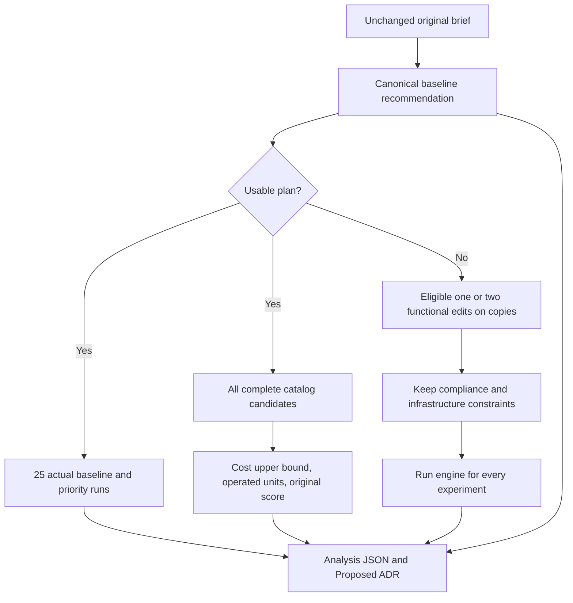
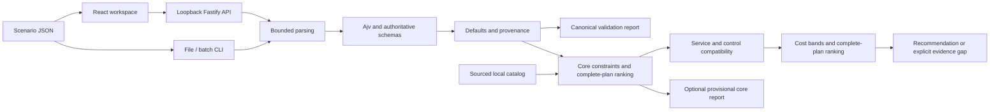
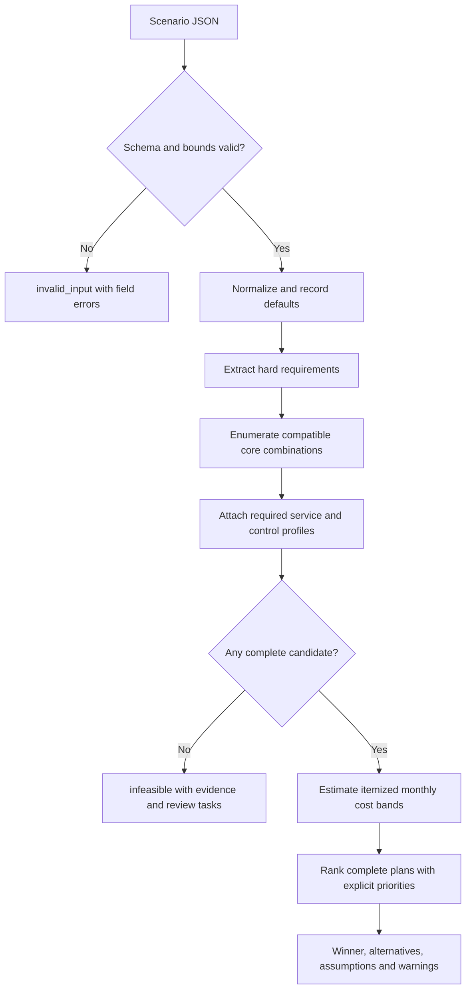
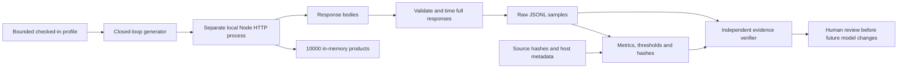
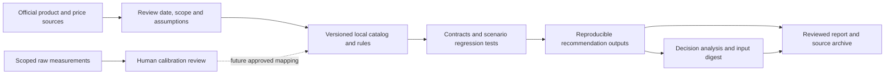

# StackSense

A local, deterministic technology stack recommendation engine for the Synergy ’26 challenge. Turn a project brief into a compatible, costed architecture with source-backed explanations—or a specific explanation of why the reviewed catalog cannot satisfy it.

StackSense evaluates the frontend, backend, database, hosting and supporting services together. Hard constraints filter candidates before explainable ranking. The same engine powers the CLI, loopback API and browser workspace; it makes no runtime LLM or external recommendation calls.

**Latest work: Phase 8** adds an isolated reference workload, raw measurements, threshold failure tests and evidence verification. These measurements do not modify architecture estimates. See [the implementation and measured results](docs/PHASE_8.md).

## Contents

- [What you can do](#what-you-can-do)
- [Run](#run)
- [Local workspace and API](#local-workspace-and-api)
- [Decision Lab](#decision-lab)
- [Complete recommendations](#complete-recommendations)
- [Provisional core planning](#provisional-core-planning)
- [Validation report](#validation-report)
- [Development and checks](#development-and-checks)
- [Current architecture and layout](#current-architecture-and-layout)
- [How a recommendation is made](#how-a-recommendation-is-made)
- [Reference workload and measurement](#reference-workload-and-measurement)
- [Troubleshooting](#troubleshooting)
- [Planning and research](#planning-and-research)
- [Submission and credits](#submission-and-credits)

## What you can do

| Capability | Result |
|---|---|
| Guided brief or JSON import | Validated inputs with explicit defaults and field-level errors |
| Single or batch evaluation | Complete recommendation or catalog/evidence-relative blockers |
| Source and control review | References, assumptions, integration tasks and evidence gaps |
| Cost exploration | Itemized USD bands, functional cost groups and usage sensitivity |
| Alternative plans | Complete plans with visible scores, costs and operational differences |
| Decision Lab | Actual priority reruns, full catalog tradeoffs and bounded functional experiments |
| Decision export | Exact JSON plus a Proposed ADR and evidence passport |
| Reference measurements | Reproducible local HTTP recipe with raw samples and acceptance checks |

A stack recommendation is a decision aid. It does not certify compliance, guarantee a provider quote or validate a production SLA.

**Application 0.7.0 adds the Decision Lab:** actual priority reruns, the full catalog tradeoff front, bounded functional experiments, and proposed ADR/evidence exports. The original recommendation engine and outputs remain 0.6.0; four public evidence blockers remain explicit. [Phase 7 implementation](docs/PHASE_7.md) · [Research and next features](docs/PHASE_7_RESEARCH.md). Owner review and online submission remain pending.

[Download the submission ZIP](https://github.com/oki-dokii/StackSense/blob/main/deliverables/StackSense26_SohamBanerjee.zip) · [Read the report](https://github.com/oki-dokii/StackSense/blob/main/output/pdf/Report_SohamBanerjee.pdf) · [Owner checklist](docs/SUBMISSION.md)


A [post-release repository comparison](docs/REPOSITORY_COMPARISON.md) identifies the remaining coverage and cost-calibration priorities; [backlog and acceptance gates](docs/IMPROVEMENT_BACKLOG.md). Three additional evidence-provenance checks now run in CI. Phase 6 implements the first improvements; remaining evidence/calibration tasks are tracked explicitly.

## Run

Prerequisites: **Node.js 22.17.0 or newer within Node 22, or Node 24 LTS**, and npm. Tested here with Node 22.17.1, npm 10.9.2, macOS arm64. GitHub CI exercises macOS, Ubuntu and Windows on Node 22/24; local setup timings are measured separately on macOS. `.nvmrc` records the tested runtime; exact dependencies are pinned in `package-lock.json`.

```sh
npm ci
npm run build
npm start
# Open http://127.0.0.1:3000
```

Run CLI evaluations independently:

```sh
npm run recommend -- --input fixtures/public/P1.json --pretty
npm run recommend:batch -- --input fixtures/public/scenarios.json --output-dir reports --pretty
npm run validate -- --input fixtures/public/P1.json --pretty
npm run validate:batch -- --input fixtures/public/scenarios.json --output-dir validation-reports --pretty
npm run plan:core -- --input fixtures/public/P1.json --pretty
npm run plan:core:batch -- --input fixtures/public/scenarios.json --output-dir core-plans --pretty
```

Export a single report, or explicitly replace an existing report:

```sh
npm run validate -- --input fixtures/minimal.json --output validation-reports/minimal.json --pretty
npm run validate -- --input fixtures/minimal.json --output validation-reports/minimal.json --force
```

When piping stdout into another program, suppress npm's own command banner:

```sh
npm run --silent validate -- --input fixtures/minimal.json
```

After building, `node /absolute/path/to/StackSense/dist/apps/cli/src/main.js --input /absolute/path/to/scenario.json` also works from another directory. Keep the complete repository, including `schemas/`, alongside `dist/`.

## Local workspace and API

After building, `npm start` serves both UI and API at **http://127.0.0.1:3000**. Optional `STACKSENSE_PORT` changes the port. Open the workspace, complete a guided brief or import JSON, then evaluate. It supports one scenario or batches of 1–100, all four statuses, source-backed explanations, blocker/integration checklists, complete-plan comparison, cost categories/sensitivity and exact JSON exports. Editing inputs marks results stale and disables export until rerun. Drafts stay in memory; reloading discards them.

For development, run `npm run dev:api` and `npm run dev:web` in separate terminals, then open http://127.0.0.1:5173. No external recommendation requests or account/API keys are needed. See [API contract](docs/API_CLI.md), [Phase 4](docs/PHASE_4.md) and [actual screenshot](docs/evidence/phase4-report-desktop.jpg).

### API examples

The built server serves the UI and API on the same origin. These commands use a supplied fixture without changing it:

```sh
curl -sS http://127.0.0.1:3000/api/health
curl -sS http://127.0.0.1:3000/api/recommend \
  -H 'Content-Type: application/json' --data-binary @fixtures/public/P3.json
curl -sS http://127.0.0.1:3000/api/recommend/batch \
  -H 'Content-Type: application/json' --data-binary @fixtures/public/scenarios.json
curl -sS http://127.0.0.1:3000/api/analyze \
  -H 'Content-Type: application/json' --data-binary @fixtures/public/P3.json
```

An HTTP success response can contain an infeasible decision: inspect the report status. The API binds to loopback, validates host/origin and bounds payloads. Browser requests from unrelated origins are rejected. It is a local workspace, with no authentication or multi-user persistence. CLI process exit codes are described below; they are separate from HTTP status codes.

```mermaid
sequenceDiagram
  actor User
  participant UI as React workspace
  participant API as Loopback API
  participant Engine as Shared engine
  participant Catalog as Reviewed local catalog
  User->>UI: Enter brief or import JSON
  UI->>API: POST /api/recommend
  API->>Engine: Validate and evaluate
  Engine->>Catalog: Read compatibility, controls and rates
  Catalog-->>Engine: Versioned evidence and assumptions
  Engine-->>API: Recommendation or explicit blockers
  API-->>UI: Canonical JSON report
  UI-->>User: Explanations, tasks and export
  User->>UI: Edit brief
  UI-->>User: Mark result stale; require rerun
```

## Decision Lab

Evaluate a brief, then choose **Analyze this decision**. Inspect preference stability and every completed catalog plan, or review bounded changed-project experiments for a blocked brief. Export analysis JSON and a **Proposed** ADR. Inspecting alternatives never changes the original recommendation; editing inputs invalidates exports.

```sh
npm run --silent analyze -- --input fixtures/public/P3.json --format json
npm run --silent analyze -- --input fixtures/public/P6.json --format adr
```

The original result still controls CLI exit status (P6 exits 3). The analysis endpoint is `POST /api/analyze`, one scenario per request. [Methods, protected fields and limits](docs/PHASE_7.md).



The retained-winner count is a tested-setting count, not a confidence probability. The tradeoff front is limited to the reviewed catalog and declared objectives. Functional experiments describe different projects; disabling a required feature does not resolve the original brief. Proposed ADRs require human review and acceptance.

## Complete recommendations

`recommend` and `recommend:batch` export the organiser output format with `ok`, `ok_with_warnings`, `infeasible` or `invalid_input`. The engine checks required service compatibility/control scope for every compatible core candidate, estimates complete plans and then ranks them. No runtime network, API keys or LLM is required.

The actual public batch returns one `ok`, one `ok_with_warnings` and four `infeasible` reports, with exit **3**. Every item exports as `<scenario_id>_output.json`; the manifest is `recommendation_manifest.json`. Inspect the [committed outputs](outputs/README.md) and [Phase 3 evidence](docs/PHASE_3.md). A no-plan cost of 0–0 means **not estimated**. P1's static assets genuinely have a zero-cost hosting band under its stated limits; P3's USD 875.51–7785.95 band includes explicit sizing/pricing assumptions and a budget-risk warning.

The service catalog has 24 profiles, 53 primary-source records and two known EOL rules, alongside the 34-entry/46-source core catalog. Sources establish reviewed building blocks; configured controls, contracts, model fit and workload targets still require project-specific verification. The output is a design, not certification or a provider quote.

## Provisional core planning

The current core catalog has **34 entries and 46 official-source records**, including AWS Mumbai and a separately scoped Azure Central India isolated compute/PostgreSQL profile. The engine checks platform/rendering coverage, explicit provider/deployment constraints, reviewed primary regions, database drivers and deployment compatibility, then applies a deterministic whole-plan rubric. Inspect [Phase 2](docs/PHASE_2.md) and [catalog evidence](docs/CATALOG.md) for exact coverage and limitations.

Core reports use `status: core_plan | blocked | invalid_input`, `scope: core_layers_only`, four selections where unblocked, source IDs, fit contributions, alternatives, assumptions, pending requirements and a rejection trace. They contain no fabricated USD cost estimate. Files use `_core_plan.json`.

**The public core batch currently returns one provisional plan and five blocked reports, with exit 3.** Core mode deliberately withholds complete control approval; unsupported regional mappings can also block. Final recommendation mode uses the complete service/control model. All reports still export. `core_plan` is not approval of complete feature, budget, SLA or compliance feasibility.

## Validation report

```text
schema_version       Validation-report format version
status               valid | invalid_input
normalized_input     Input with recorded defaults, or null when invalid
assumptions[]        Every applied default and normalization interpretation
warnings[]           Preserved unknown fields and unapplied extensions
validation_errors[]  All discoverable field-level problems
```

These reports are separate from the challenge's recommendation output schema and use `_validation.json` filenames. They must not be submitted as `P1_output.json`–`P6_output.json`.

CLI exit codes: **0** valid/core plan/usable recommendation, **2** invalid input, **3** blocked/infeasible plan, **1** usage/filesystem/internal error. A mixed batch prioritizes invalid input over blocked plans. Use `--help` for options. Input limit: 2 MiB; batch: 1–100 scenarios; nesting: 32 levels. Batch processes invalid items independently, sanitizes filenames, and writes `validation_manifest.json`. It refuses existing files unless `--force` is supplied, and refuses to overwrite the input through direct or symlink-alias paths. Writes are atomic per file, not a transaction across the whole batch. Malformed containers produce one root error on stdout.

No API keys, environment variables, LLM features, or runtime network services are needed. `--no-llm` is accepted as a no-op. Dependencies need network access during the initial install.

## Development and checks

```sh
npm run generate:types   # regenerate TS types after editing schemas
npm run check           # generated type freshness, type checking, tests
npm run build
npm run dev:validate -- --input fixtures/minimal.json --pretty
npm run evaluate         # author-designed unseen-style and sensitivity evidence
npm run verify:release   # verify all actual output snapshots
node --test scripts/tests/evidence-bindings.test.mjs scripts/tests/calibration.test.mjs
node benchmarks/reference/verify.mjs evaluation/calibration/reference-run-1
python3 scripts/check_docs.py
```

Optional deeper documentation contract checks require Python's `jsonschema` package; see [schema guidance](schemas/README.md). Current verification: [Phase 7](docs/PHASE_7.md): **235 tests pass**, plus three capture-provenance and five reference-workload checks, with a successful build. Current local API/cached setup timings are recorded there; these do not measure recommended-workload behavior.

| Technology | Pinned version | Role |
|---|---|---|
| TypeScript | 5.9.3 | Shared contract/CLI code |
| Ajv | 8.20.0 | Standard JSON Schema validation without coercion |
| json-schema-to-typescript | 15.0.4 | Generate types from authoritative schemas |
| tsx | 4.23.15 | Source-mode development CLI |
| Vitest | 5.1.0 | Contract and real CLI subprocess tests |
| Fastify / @fastify/static | 5.12.8 / 10.1.10 | Loopback API and bundled asset serving |
| React / react-dom | 19.3.1 | In-memory responsive workspace |
| Vite | 8.3.8 | Browser build and development proxy |
| @types/react / @types/react-dom | 19.3.0 | Browser TypeScript definitions |
| @types/node | 22.20.5 | Node runtime types |

## Current architecture and layout



```text
apps/cli/src/              Bounded file IO, safe output, CLI adapter
apps/api/src/              Loopback HTTP API and same-origin web serving
apps/web/src/              React guided brief, imports, results and exports
packages/contracts/src/    Generated types, validation, normalization, canonical JSON
packages/catalog/          Reviewed source/product/deployment catalog and integrity checks
packages/engine/src/       Features, constraints, complete-plan search, services, costs, explanations
schemas/                   Authoritative organiser input/output contracts
fixtures/public/           Supplied array and six individual scenarios
tests/                     Contract, engine, actual CLI/API and release invariant checks
benchmarks/reference/      Isolated HTTP workload, bounded generator and evidence verifier
evaluation/                Actual outputs, cases, API timings and raw workload evidence
output/pdf/                Verified final report
deliverables/              Ready-to-review submission ZIP
scripts/                   Type generation and documentation checks
docs/                      Product, design, research and implementation evidence
dist/                      Generated build; ignored by Git
```

API/UI boundaries and remaining evidence work: [TRD](docs/TRD.md). Core selection uses local rules, hard constraints, compatible-plan search and explainable ordinal ranking. No LLM will choose the stack.

## How a recommendation is made



Hard constraints include supported deployment/provider mappings, compatibility and reviewed control/region scope. A high preference score cannot compensate for a failed hard constraint. Unknown prices, capacity proxies and external-service scope are disclosed rather than silently treated as proof. Cost sensitivity holds the selected architecture fixed; it does not promise the same selection under a different project brief.

The six public fixtures are supplied inputs, not a training set or official expected answers:

| Fixture | Current result | Interpretation |
|---|---|---|
| P1 | `ok` | Astro static assets on Cloudflare Pages; genuine zero-cost band within stated limits |
| P2 | `infeasible` | Required phone/payment scope lacks sufficient end-to-end India evidence |
| P3 | `ok_with_warnings` | Angular / Fastify / PostgreSQL / Cloud Run; USD 875.51–7785.95 monthly band |
| P4 | `infeasible` | Required service/control evidence remains incomplete |
| P5 | `infeasible` | Existing Entra tenant scope remains unresolved despite the scoped Azure India core profile |
| P6 | `infeasible` | Required phone-login evidence remains incomplete |

Inspect each [output](outputs/README.md) for its full reasons. `infeasible` is relative to this catalog and its reviewed evidence. For no-plan outputs, `estimate_status: not_estimated` and the required 0–0 serialization are not a zero-cost architecture. Scores are authored ordinal heuristics; cost bands are estimates.

## Reference workload and measurement

There are three distinct measurement families: [StackSense API timing](evaluation/performance.json), [Decision Lab timing](evaluation/decision-lab-results.json), and the [reference HTTP workload](evaluation/calibration/reference-run-1/summary.json). None measures a deployed recommended production stack.

```sh
# No build or API server is needed. Requires the supported Node runtime.
# Choose a new output directory for every run.
node benchmarks/reference/run.mjs --out tmp/calibration/my-run
node benchmarks/reference/verify.mjs tmp/calibration/my-run
```

The runner launches its own child server on an ephemeral loopback port, validates every response and saves all measured requests as JSONL. It uses 10,000 in-memory products, an 80/20 read/search schedule, 50 warmups, concurrency 1/4/16, and a 2-second or 20,000-sample bound per stage. The profile declares p95 ≤100 ms, zero errors and at least 100 completed requests as author-defined smoke gates. A failed gate returns process exit 1 and preserves the evidence. A verifier success means integrity passed; inspect `passed` separately for metric acceptance.



The committed run completed **56,687 requests with zero errors**. Its p95 values were **0.225 / 0.403 / 2.445 ms** at concurrency 1/4/16. The last two stages hit the sample cap early; exact elapsed times are retained. These are short same-host, closed-loop observations, with no database, auth, TLS, external network or cloud deployment. They do not determine monthly cost, sustained capacity or SLA. See [Phase 8 methodology, limits and next calibration gate](docs/PHASE_8.md).

### Evidence maintenance



Network research does not automatically change selection rules. The reviewed report is the Phase 7 report; Phase 8 measurements are documented separately and included in the source archive. No independent expert acceptance or online submission is implied by a passing build.

## Troubleshooting

| Symptom | Action |
|---|---|
| `dist` entry point missing | Run `npm run build` before `npm start` or compiled CLI commands |
| Unsupported Node or install/build errors | Use `.nvmrc` or supported Node 24, then `npm ci`; do not replace the lockfile casually |
| Port 3000 already in use | Stop the existing process or run `STACKSENSE_PORT=3001 npm start` on macOS/Linux; PowerShell: `$env:STACKSENSE_PORT=3001; npm start` |
| Browser origin rejected | Open the loopback workspace directly; use the Vite proxy for development |
| Result export disabled | Rerun evaluation after editing input |
| Public batch exits 3 | Expected: four public inputs currently have explicit infeasibility results; inspect exported reports |
| Existing output refused | Choose a new destination; CLI report commands also support explicit `--force` |
| Benchmark gate fails | Inspect `summary.json` checks and raw samples; rerun into a new directory and compare the recorded host/profile |
| Benchmark verifier rejects changed sources | Preserve historical evidence with its source revision; create a fresh run for changed workload code |
| Python schema check lacks `jsonschema` | Follow [schema tooling guidance](schemas/README.md); core Node build does not require Python |

## Planning and research

Start with [plan.md](plan.md), the [phase tracker](docs/PHASES.md), and [documentation index](docs/README.md). Product/design contracts: [PRD](docs/PRD.md), [SRS](docs/SRS.md), [UI/UX](docs/UI_UX.md), [workflows](docs/WORKFLOWS.md). Research: [annotated review](docs/RESEARCH_REVIEW.md), [sources](docs/research/sources.json), [decisions](docs/DECISIONS.md).

## Submission and credits

The report, 20 genuine public/evaluation outputs, screenshot evidence, local setup/API measurements and submission ZIP are prepared. Owner review, Drive access verification and Unstop submission remain required. Broader regional/vendor evidence, deployed-workload cost calibration and independent expert validation remain limitations. See [submission checklist](docs/SUBMISSION.md). Deadline in the supplied brief: **15 November 2026, 23:59 IST**; do not modify the submitted Drive folder afterward.

Requirements come from user-supplied `StackSense_Problem_Statement.pdf` v1.0; public fixtures from `stacksense_public_scenarios.json`. No official expected stacks were provided. All installed third-party tools are listed above and locked in `package-lock.json`; source links/research and AI assistance are recorded in [references](docs/REFERENCES.md) and [AI assistance](docs/AI_ASSISTANCE.md). Participant review/ownership remains required by the challenge.
