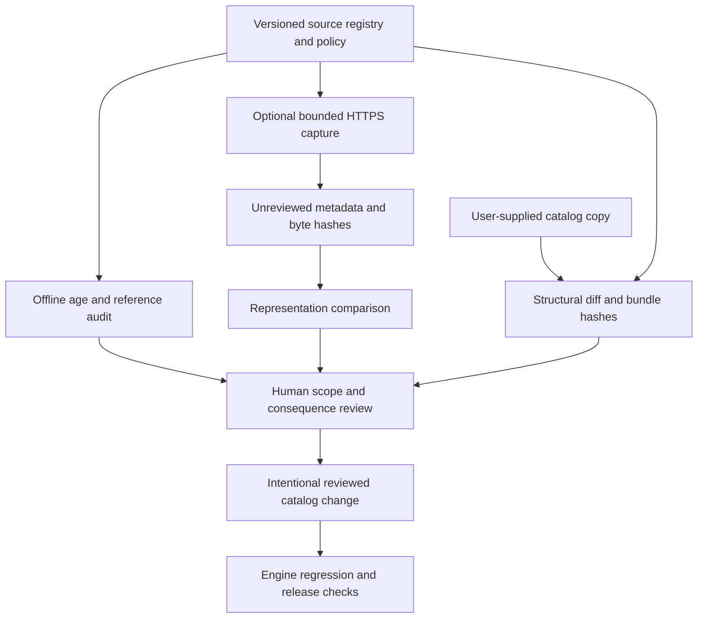

# Phase 10: evidence freshness and change review

Implemented 14 November 2026 IST. Evidence tooling 0.1.0 audits the reviewed catalogs, produces candidate change records and compares bounded URL observations. Application 0.7.0, engine 0.6.0 and all standard recommendations remain unchanged. This is an opt-in maintenance CLI, not a new recommendation endpoint or an automatic source updater.

## Audit all registered sources offline

```sh
npm ci
node scripts/evidence.mjs audit --as-of 2026-11-14 --out tmp/evidence/audit-1
# Optional automation gate; exit 2 when recorded review dates are due or future-dated:
node scripts/evidence.mjs audit --as-of 2027-02-14 --fail-on-due --out tmp/evidence/future-audit
```

`--as-of` is required and must be a real calendar date. Choose the review date intentionally; there is no implicit wall-clock freshness claim. The output directory must be new. Reports are emitted as JSON and escaped Markdown; neither catalog nor input files are written.

The [committed audit](../evaluation/evidence-review/current/report.md) covers **99 source records**: 46 core and 53 service sources. As of 14 November 2026, none is due under the declared policy and none has a future review date. This reflects recorded dates, not 99 live revalidations.

The report includes namespaced source keys, URL/scope/review date, age, due date, categories, catalog JSON-pointer consumers and mentions in the six committed public reports. Output mentions include alternatives and guidance, not just selected-plan dependencies. ID-only references conservatively match both namespaces if a future catalog reuses an ID. Full reference objects additionally match ID and URL. This is direct-reference tracing, not exhaustive transitive impact analysis.

Five sources have no structured catalog `source_ids` consumer: Azure VNet integration, Entra OIDC/residency, Razorpay privacy and SQL Server 2019 lifecycle. They support hardcoded guidance and are not declared unused. Their public-report mentions remain visible. Explicit policy category bindings cover these guidance-only records.

## Author-defined review cadence

| Category | Reminder interval | Attribution |
|---|---:|---|
| Pricing | 14 days | Structured `/pricing/` references |
| Region or controls | 30 days | Region/managed-database/control paths, framework definitions, and explicit scope bindings |
| Lifecycle | 30 days | Structured lifecycle rules and explicit SQL Server lifecycle binding |
| Capability | 90 days | Other references, or fallback when no structured consumer exists |

The [versioned policy](../scripts/evidence/policy.json) is an author choice. It is not a vendor commitment, legal deadline, source expiry or probability of correctness. The shortest applicable interval wins. A source is due when its age reaches the interval, including the exact boundary. Future review dates are flagged separately. Schema-invalid catalogs, duplicate/unknown source references, impossible dates and unknown policy bindings are rejected. Unknown category bindings require a policy change, not a guessed scope from page text.

## Compare a proposed catalog safely

```sh
mkdir -p tmp/catalog-candidate
cp packages/catalog/data/catalog.json tmp/catalog-candidate/catalog.json
cp packages/catalog/data/services.json tmp/catalog-candidate/services.json
# Edit only the copied files after researching the proposed change.
node scripts/evidence.mjs compare --base packages/catalog/data --candidate tmp/catalog-candidate --as-of 2026-11-14 --out tmp/evidence/proposal-1
```

Both directories must contain `catalog.json` and `services.json`. Loading checks their existing schemas and source/date bindings; this is not a complete engine compatibility or compliance validation. The structural diff records field paths, before/after values, conservative ancestor/subtree source attribution, canonical bundle/policy SHA-256 digests and a **pending** human-review template. Reordered arrays can create review noise. Changes without a directly attributable source retain empty attribution and require manual review.

The [committed tariff example](../evaluation/evidence-review/synthetic-tariff-proposal/report.json) is **synthetic**: it changes the Cloud Run minimum planning rate by USD 0.01 and labels the basis as synthetic. It is not an observed provider rate or an accepted pricing update. The actual catalog and P3 cost band are unchanged.

The reviewer template calls for scope/units/region/date review, provider-fact versus authored-assumption separation, compatibility/control implications, scenario regressions and release/version updates. Reviewer, date, notes and supporting references are empty. Tooling does not invent a reviewer, authenticate an approval or enforce a new engine write gate. Accepted changes still require an intentional normal code/catalog change and relevant validation. The maintenance CLI has no apply command and cannot automatically promote an observation or candidate.

## Optional registered-URL observations

```sh
node scripts/evidence.mjs capture --keys services:python2-eol,services:angularjs-eol --out tmp/evidence/observations-a
node scripts/evidence.mjs capture --keys services:python2-eol,services:angularjs-eol --out tmp/evidence/observations-b
node scripts/evidence.mjs compare-captures --base tmp/evidence/observations-a/report.json --candidate tmp/evidence/observations-b/report.json --out tmp/evidence/observation-diff
```

Capture is the only network command. It accepts 1–3 unique source keys from the repository's current reviewed registry, not an arbitrary target URL or candidate catalog. HTTPS is required; redirects are recorded as retrieval failure rather than followed. Each request has a 10-second timeout and 2 MiB streamed-body limit; no retries. Headers are bounded. The capture stores HTTP status, actual observation timestamp, content type, ETag/Last-Modified if supplied, byte count and response SHA-256. Full third-party content is neither stored in the artifact nor executed/interpreted as instructions.

A 200 response becomes `retrieved_unreviewed`; failures are preserved. There is no conditional GET/304 cache implementation. The bytes hashed are those delivered by the fetch response body, not an authenticated wire transcript. Compression, markup, localization and dynamic content can affect hashes. Equal bytes do not prove the continued applicability of a fact; changed bytes do not establish changed facts. URL changes, missing observations, first success, retrieval failure and representation changes are distinct comparison states. Fetching never resets `checked_on` or changes a review date.

The two committed captures each retrieved the public Python 2 and AngularJS lifecycle URLs successfully. Both URLs had matching digests across the two captures. These are **four actual HTTP observations**, not semantic re-review of either lifecycle rule. An old Last-Modified header is retained as response metadata, not treated as a source review date.



The final two steps are the documented maintenance process; they are not automatic actions performed by the CLI.

## Exit codes, integrity and tests

- **0:** successful report generation. A pending proposal or verified observation is not an approval.
- **2:** audit with `--fail-on-due` finds a due/future date; or at least one requested capture fails. Reports are still retained.
- **1:** usage, bounded-input/schema, filesystem or execution error. Existing output directories are refused.

```sh
node --test scripts/tests/evidence-review.test.mjs
node scripts/evidence/verify.mjs
```

Fourteen tests cover date arithmetic, cadence boundaries/overrides, source consumers and guidance-only references, immutable hash-bound proposals, invalid catalog bindings, bounded capture/redirect/error behavior, representation comparisons, untrusted text escaping and actual CLI output/exit/overwrite behavior. Tests inject HTTP responses; CI does not depend on live vendor endpoints.

The integrity verifier recomputes the current audit, validates observation registry binding, reproduces representation/synthetic comparisons, checks Markdown parity and verifies artifact/tool byte hashes in the [manifest](../evaluation/evidence-review/manifest.json). `--record` explicitly re-records the integrity manifest during maintenance. Hashes and a locally editable manifest detect accidental/stale changes; they are not cryptographic signatures or independent human approval. The current audit is frozen to its declared date, so CI does not silently fail from passing time; run a new audit intentionally for a later date.

## Research basis and remaining work

[RFC 9110](https://www.rfc-editor.org/rfc/rfc9110.html) distinguishes representations and validators such as ETag/Last-Modified. These are recorded as HTTP metadata, not interpreted as human review. The [W3C PROV overview](https://www.w3.org/TR/prov-overview/) motivates keeping data, activities and reviewers distinct; this implementation does not claim PROV serialization or standards conformance.

This phase does not refresh all 99 facts, obtain tenant/vendor contracts, calibrate cloud billing, establish transitive impact completeness or complete accessibility/independent review. The report PDF remains the reviewed Phase 7 artifact. New maintenance records and methods are included separately in the source package. Next independent work: broader keyboard/screen-reader/browser accessibility QA and uncached-machine setup; deployment/billing calibration remains a separate external-evidence gate.
