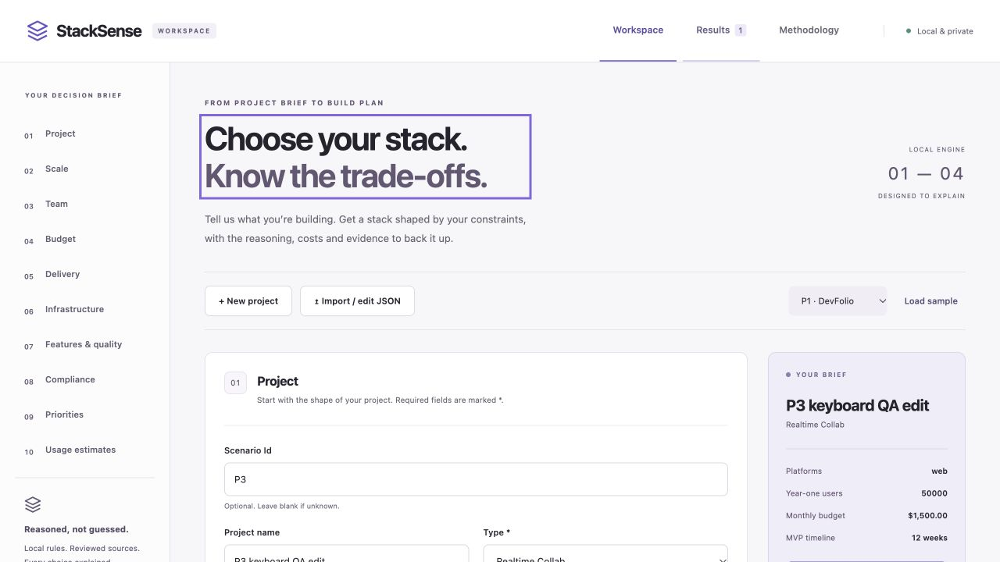

# Phase 11: keyboard focus, contrast and narrow-layout QA

Implemented 14 November 2026 IST as maintenance of the 0.7.0 workspace. Recommendation engine 0.6.0, source review dates, rules and output recommendations remain unchanged. The checked-in source/lockfile fingerprint and new captures identify this maintenance revision separately from earlier 0.7.0 screenshots.

## Findings and fixes

Actual in-app Chromium keyboard checks found that navigating to Methodology left focus on its navigation button and retained the generic page title. Sidebar shortcuts scrolled without moving focus. The JSON disclosure had no explicit controlled-region association or editor/return-focus behavior. The custom contrast check flagged 37 leaf text elements on the initial workspace, including section numbers, sidebar labels, summary labels and footer text.

Changes:

- Route changes and browser history events update the page title and focus the destination heading. Initial loading preserves normal keyboard entry through the existing skip link.
- Invalid-result navigation prioritizes the validation-error summary over the page heading. A browser retest caught and fixed a race between the new heading focus and the existing evaluation focus.
- Sidebar shortcuts move focus to the requested form section, including after returning from another route.
- Opening the JSON disclosure focuses its editor; closing, cancelling or successfully applying it returns focus to the trigger. `aria-controls` identifies the region.
- Muted text colors are darker on their existing pale backgrounds. White button text and status colors that already met the sampled thresholds are preserved. Focus outlines remain visible in captures.

The mobile section selector's existing scroll behavior is retained; no unexpected focus move was added to selection changes. The form still uses server-derived validation summaries and error links; comprehensive inline `aria-invalid`/error association is not claimed.

## Regression tests

```sh
npm ci
npm run check
# Focused component suite:
npx vitest run tests/web-accessibility.test.ts
# Verify saved browser evidence and source binding:
node scripts/accessibility/verify.mjs
```

Six new tests mount the actual React App in jsdom and exercise initial focus, route/history focus and titles, cross-route section shortcuts, disclosure focus restoration, import-error alert focus, and invalid-result/error-link focus. The invalid result is produced by the actual recommendation engine from a field-invalid fixture, rather than a manually incomplete report mock. jsdom does not test browser layout or assistive technology; real browser observations below complement it.

jsdom 27.4.0 is pinned as a development dependency because its Node requirements include the project's Node 22.17.1 runtime. The newer registry default observed during work requires a later runtime and was not selected. The updated lockfile's registry audit reports zero advisories; this is not a complete security assessment.

## Actual browser checks

The supported computer-use browser performed keyboard activation and DOM inspection against the built same-origin local app. It did not run an external browser automation process. Seven saved [audit snapshots](../evaluation/accessibility/manifest.json) bind the audited source and lockfile to report/capture hashes:

| Snapshot | Viewport | Tested leaf text elements | Recorded contrast/name/description/duplicate-ID findings |
|---|---|---:|---:|
| Workspace with edited P3 draft | 1280 × 720 | 159 | 0 |
| Methodology | 1280 × 720 | 141 | 0 |
| JSON parse error | 1280 × 720 | 167 | 0 |
| Invalid-input result | 1280 × 720 | 50 | 0 |
| P3 Decision Lab | 1280 × 720 | 626 | 0 |
| Workspace with imported empty object | 320 × 800 | 142 | 0 |
| P3 Decision Lab | 320 × 800 | 632 | 0 |

Cases intentionally differ: the edited P3 workspace is not the unchanged public fixture. The Decision Lab/export checks use the original P3 input. The import-error screenshot was taken earlier with the starter draft and malformed JSON; its later audit snapshot has the edited P3 draft with the same malformed editor content. They are not asserted to be the same exact UI state.

Additional observations:

- Native Tab/Enter reached the existing skip link and focused `main` before patching; initial focus behavior is preserved by the component regression test.
- Keyboard-activated Methodology focused its heading and changed the title. A Budget shortcut focused `section-budget`.
- Opening, erroring and closing/applying JSON preserved the expected editor/alert/trigger destinations.
- Invalid evaluation focused `validation-errors`; activating its Budget error link focused the form section.
- At 320 pixels, document width remained 320. The 600-pixel chart stayed inside a 244-pixel region with `tabindex=0`; ArrowRight moved its horizontal scroll to 40 pixels after the browser settled.
- Keyboard-triggered P3 JSON download matched the committed original result as parsed JSON. Editing the draft then disabled the stale-result export.
- Temporary viewport overrides were reset. No user inputs, accounts or external recommendations were involved.



## What the custom audit does and does not prove

[dom-audit.mjs](../scripts/accessibility/dom-audit.mjs) is a small **read-only, leaf-element** DOM inspection function, run through the supported browser evaluator. It computes relative luminance and contrast for RGB text over composed solid backgrounds and checks for basic empty control names, missing description/label targets and duplicate IDs. It records document width, primary landmarks and current focus. Normal text uses a 4.5:1 threshold; sufficiently large text uses 3:1. There is no rounding up to make a ratio pass.

This is **not axe, a full accessibility tree checker or a WCAG conformance audit**. It skips non-leaf text, SVG/chart labels, hidden/inactive text, control values rendered by native widgets, and opacity/gradient situations. Zero recorded findings applies only to the sampled elements and these limited rules. It does not establish semantic reading order, complete accessible-name computation, non-text/control-boundary contrast, focus obscuring, touch targets, browser zoom, reduced-motion behavior or assistive-technology usability.

The verifier checks saved artifact/source hashes, basic expected state/width assertions and absence of recorded findings. CI reruns the component tests and checks those saved artifacts; it does not silently rerun Chromium or validate current layout on every CI host. `--record` re-records hashes deliberately during maintenance and is not an independent attestation.

## Research and remaining gates

The implementation was guided by W3C's [contrast explanation](https://www.w3.org/WAI/WCAG22/Understanding/contrast-minimum.html), [focus-order explanation](https://www.w3.org/WAI/WCAG22/Understanding/focus-order.html) and [form notification guidance](https://www.w3.org/WAI/tutorials/forms/notifications/). These inform focused fixes; they do not certify this application.

Still open: VoiceOver/NVDA testing with real users, Safari/Firefox/browser matrix, 200–400% zoom and text spacing, full semantic/control/target-size checks, inline error associations, and an actual uncached-machine installation. Cloud workload/billing calibration and independent architecture review also remain separate gates.

The PDF remains the reviewed Phase 7 report; this source package includes the subsequent maintenance records and captures separately. Standard recommendation snapshots remain byte-for-byte unchanged.
