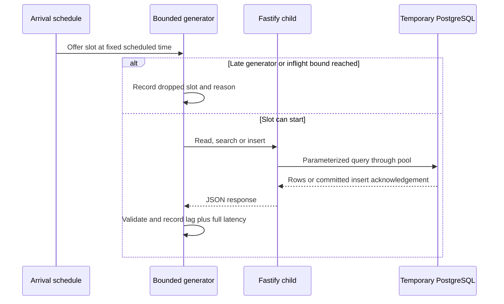

# Phase 9: Fastify and PostgreSQL reference recipe

Implemented 14 November 2026 IST. This phase extends the measured-workload roadmap to a real database, scheduled arrivals, committed writes and repeated rate stages. Application 0.7.0, engine 0.6.0 and all recommendation estimates remain unchanged. It exercises two P3 technology families, not the complete Angular/Cloud Run/payment architecture.

## Reproduce locally

Prerequisites: supported Node 22/24, npm, a non-root macOS/Linux user, and PostgreSQL **18.1** server binaries (`postgres`, `initdb`) installed locally. This is the installed historical test patch, not a recommendation for a new production deployment. Review current PostgreSQL patch guidance separately. Native Windows is not supported by this Unix-socket launcher; use Linux/WSL for measurement. The benchmark dependencies are isolated from application dependencies and pinned in their own lockfile.

```sh
npm ci --prefix benchmarks/postgres
# If the PostgreSQL bin directory is already on PATH:
node benchmarks/postgres/run.mjs --out tmp/calibration/postgres-new-run
# macOS installation used for the committed run:
STACKSENSE_PG_BIN=/Library/PostgreSQL/18/bin node benchmarks/postgres/run.mjs --out tmp/calibration/postgres-another-run
node benchmarks/postgres/verify.mjs tmp/calibration/postgres-new-run
node --test benchmarks/postgres/tests.mjs
```

The output must be a new directory. The launcher creates an owner-only temporary cluster, seeds it, starts a separate loopback HTTP process, measures, closes its clients/processes and removes its own cluster. PostgreSQL listens on a Unix socket inside the private directory; TCP listening is disabled. No existing database connection string or external HTTP target is accepted. `trust` authentication applies only within this disposable, private socket recipe; it is not a production authentication design. Normal errors and handled interruptions run cleanup; an uncatchable kill can leave a private temporary directory requiring cleanup.

The local Docker daemon was stopped, so no local container deployment is claimed. CI adds a separate Linux `postgres:18.1` service integration job using disposable credentials and a uniquely named test schema. The version tag is explicit; its image digest is not pinned. The six OS/Node application jobs run scheduler/body/integrity tests with the live-database case explicitly skipped. The database job enables that case. No throughput threshold is asserted on shared CI hardware.

## Recipe and measurements

| Component | Configuration |
|---|---|
| HTTP | Fastify 5.12.8, Node 22.17.1 for measured run, separate process, loopback HTTP |
| SQL driver | pg 8.23.1, bounded pool of 8, parameterized SQL, 1-second query/connection timeout |
| Database | PostgreSQL 18.1, 20 max connections, 32 MiB shared buffers; CPU and total memory not isolated |
| Durability settings | `fsync`, `synchronous_commit`, `full_page_writes` all on; recorded from actual server |
| Data | 10,000 products, 256-byte description each, primary key and category/id index |
| Mix | Per ten scheduled slots: eight point reads, one indexed category query returning 20 products, one committed insert |
| Arrival profile | 100 then 300 requests/sec, 3 seconds per stage, repeated three times; 50 serial warmup requests before each stage |
| Generator bounds | Max 32 inflight, 1-second request timeout, 50 ms maximum start lag, no retries |
| Acceptance | p95 scheduled-to-completion ≤100 ms, error rate 0, dropped-slot rate 0, committed row count equals acknowledged writes |

The scheduler offers each slot independently of previous request completion. A late scheduler or full inflight bound records a drop instead of silently waiting for a worker. Every offered slot appears in raw JSONL, including drops. Issued failures remain in latency statistics; drops have no fabricated latency and have a separate denominator. Latency includes body consumption and validation; scheduled-to-completion latency additionally includes generator delay. Nearest-rank p95 and raw/source/profile hashes are independently checked.



## Actual local results

The [measured summary](../evaluation/calibration/postgres-run-1/summary.json) contains six stages, **3,600 offered/issued requests, zero errors and zero drops**. p95 scheduled-to-completion ranged from **2.817 to 4.659 ms**. The fresh SQL connection found **390 committed events**, matching all acknowledged writes including 30 warmup inserts. This verifies visibility after commit acknowledgement, not crash recovery or backup restoration.

| Repetition | Target requests/sec | Offered | Errors | Drops | p95 scheduled-to-completion ms |
|---|---:|---:|---:|---:|---:|
| 1 | 100 | 300 | 0 | 0 | 4.659 |
| 1 | 300 | 900 | 0 | 0 | 2.817 |
| 2 | 100 | 300 | 0 | 0 | 4.239 |
| 2 | 300 | 900 | 0 | 0 | 2.918 |
| 3 | 100 | 300 | 0 | 0 | 3.736 |
| 3 | 300 | 900 | 0 | 0 | 3.262 |

These are repetitions within one short, progressively warmed cluster, not independent fresh-host replications or steady-state saturation tests. Query keys follow a skewed deterministic pattern. The product relation was approximately 3.8 MB including indexes, and fits in memory. This does not represent a large production database. PostgreSQL settings, relation/database sizes, CPU model, OS and runtime are preserved in the summary; per-component CPU/RSS, I/O saturation and billing are not measured here.

Eight tests cover bounded scheduling with real inflight drops, deterministic generator-lag drops, error/drop denominators and latency, invalid profiles, payload/operation correctness, HTTP rejection before DB access, real SQL reads/search/committed/duplicate writes in a separate schema, and saved-evidence tampering. Seven run without a live DB; the eighth is enabled explicitly with `STACKSENSE_TEST_DATABASE=1` and standard `PGHOST`, `PGPORT`, `PGUSER`, `PGPASSWORD`, `PGDATABASE` variables. Only use that mode on a database where you authorize creating and removing its uniquely named schema.

## Research and design basis

- [node-postgres pooling](https://node-postgres.com/features/pooling): use one bounded pool and close it; no unbounded per-request connections.
- [PostgreSQL initdb](https://www.postgresql.org/docs/18/app-initdb.html) and [pg_ctl](https://www.postgresql.org/docs/18/app-pg-ctl.html): isolate the cluster and run as its non-root owner.
- [PostgreSQL WAL configuration](https://www.postgresql.org/docs/18/wal-configuration.html): durability and checkpoint behavior affect results. These short runs do not establish checkpoint-cycle behavior or crash recovery.
- [Grafana arrival-rate allocation](https://grafana.com/docs/k6/latest/using-k6/scenarios/concepts/arrival-rate-vu-allocation/): offered load and available execution capacity must both be explicit. Our small custom scheduler records overload/lag; it is not a k6 execution or equivalence claim.
- [GitHub PostgreSQL service guidance](https://docs.github.com/en/actions/tutorials/use-containerized-services/create-postgresql-service-containers): real database correctness gets a separate Linux service job.

## Gate before changing architecture costs

The [calibration review template](../benchmarks/postgres/calibration-review.json) explicitly keeps cloud deployment, observed billing and model mapping pending. Before changing sizing/cost coefficients, collect:

1. Exact selected-stack versions, deployment revision/image digest, provider SKU/region, CPU/memory limits, database configuration and connection topology.
2. Project-representative payloads, data distribution/size, read/write mix, indexes, auth, TLS and external dependencies.
3. External generator, clock/lag/drop evidence, longer warmup and steady-state repetitions covering checkpoint/autovacuum effects; independent reruns and per-component resource measurements.
4. Actual billing exports with metered units/time window, baseline idle cost, taxes/currency/discount treatment and capacity headroom assumptions.
5. Reviewer identity/date, disagreements, accepted mapping uncertainty and regression evidence. Until accepted, preserve current engine coefficients.

No cloud resources were provisioned, no billing observed, and no monthly-cost calibration is claimed. The reviewed PDF remains the Phase 7 report; Phase 9 evidence is provided separately in documentation and the source archive.
