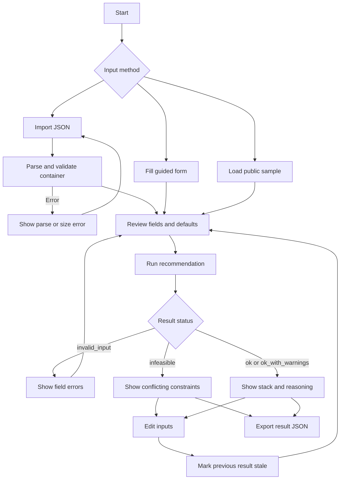
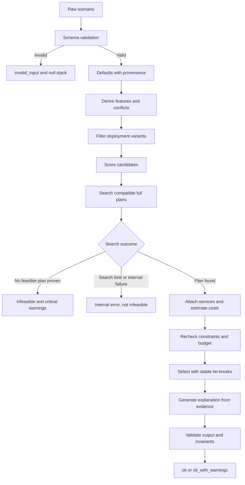
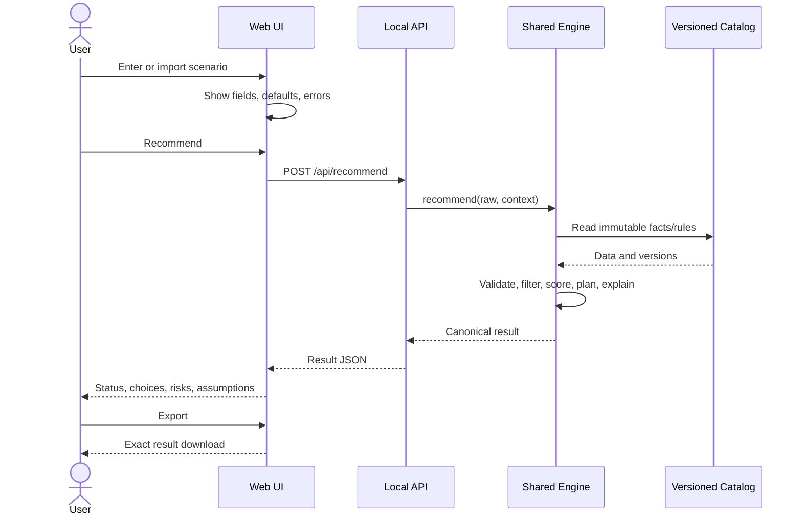
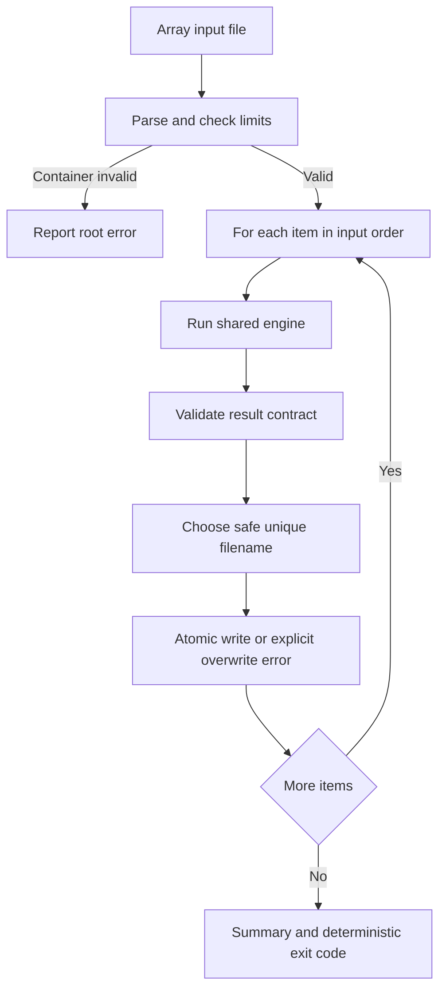
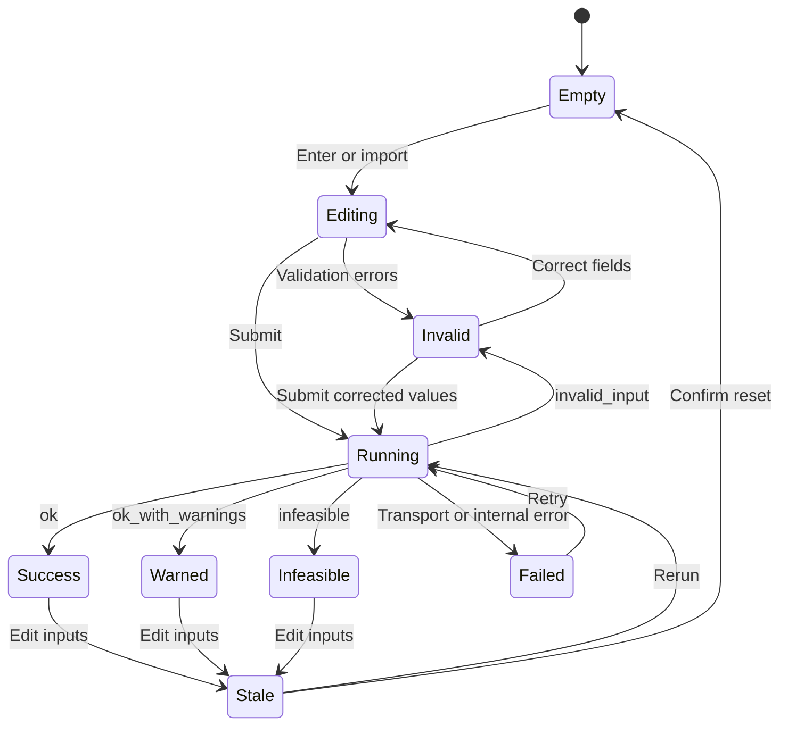

# Flow diagrams

These describe planned behavior. Mermaid source files can be edited independently; rendered versions follow.

## User Journey

[Editable source](01-user-journey.mmd)

## Engine Pipeline

[Editable source](02-engine-pipeline.mmd)

## Request Sequence

[Editable source](03-request-sequence.mmd)

## Batch Evaluation

[Editable source](04-batch-evaluation.mmd)

## Ui State

[Editable source](05-ui-state.mmd)

