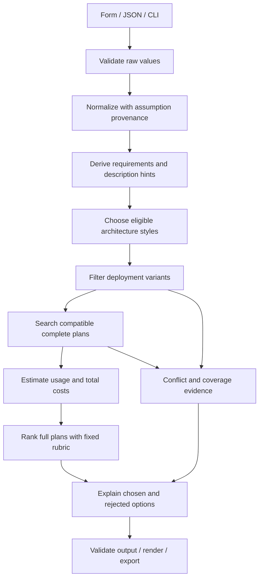

# StackSense — research-backed implementation plan

Version 0.2 · 13 November 2026 IST · Phases 1–2 contracts/CLI and provisional core planner implemented; later phases remain proposed. See [actual progress](docs/PHASES.md) and [Phase 1 evidence](docs/PHASE_1.md).

Build one local, deterministic, evidence-backed architecture recommendation engine. It must select a compatible frontend/backend/database/hosting combination, add necessary supporting services, explain its decisions, estimate costs, and honestly report invalid or unsupported scenarios. The six public projects are evaluation inputs, not six applications to build.

This plan is informed by a [30-source research review](docs/RESEARCH_REVIEW.md) and [source register](docs/research/sources.json). It refines the existing [PRD](docs/PRD.md), [SRS](docs/SRS.md), [TRD](docs/TRD.md) and [roadmap](docs/ROADMAP.md). Organiser requirements remain authoritative. Literature findings and our proposed engineering decisions are distinguished throughout.

## 1. Research conclusion and chosen direction

**Choose a knowledge-based constraint recommender with deterministic complete-plan ranking.** Explicit requirements and a curated catalog are available; a labeled history of project outcomes is not. Knowledge-based research supports this problem framing, while highlighting the cost of acquiring/maintaining reliable knowledge. [R01](https://www.frontiersin.org/journals/big-data/articles/10.3389/fdata.2024.1304439/full)

The closest direct precedent is the software-technology-selection DSS: alternatives, domain features, quality attributes, and hard/soft preferences are modeled separately. Adopt that separation; extend it to cross-layer compatibility and supporting-service data flows. This extension is our design, not a result established by the DBMS study. [R02](https://slingerjansen.nl/wp-content/uploads/2018/05/a-decision-support-system-for-software-technology-selection.pdf)

CloudGenius makes component compatibility explicit; CloudRecommender normalizes heterogeneous infrastructure configurations. Our inference: score deployment-specific plans rather than independently choosing popular products. Their historical service catalogs must not be reused as current facts. [R05](https://arxiv.org/abs/1112.3880), [R04](https://arxiv.org/abs/1210.2047)

### Approach comparison

| Approach | Strength | Problem here | Decision |
|---|---|---|---|
| Project-type lookup | Fast and simple | Fails changed skills, residency, budget and deployment | Reject as engine; use archetypes only as explainable features |
| Collaborative filtering / trained ranker | Learns from actual outcomes | No labeled outcomes or user-item history supplied | Defer until an appropriate dataset exists |
| LLM stack prompting | Flexible natural-language output | Violates challenge selection policy; weak reproducibility | Reject for selection |
| Rules only | Clear eligibility and explanations | Can become brittle without comparative preferences | Use for constraints/capabilities, not all ranking |
| Weighted scoring only | Easy prioritization | Cannot compensate for a prohibited region/runtime | Use after hard feasibility |
| AHP/TOPSIS | Established multi-criteria families | More elicitation/calibration than supplied 1–5 priorities require | Research comparisons; no MVP dependency |
| Constraint + compatibility + fixed rubric | Auditable, deterministic, fits structured inputs | Needs researched catalog and careful rule validation | Selected |
| CP-SAT / SMT solver | Rich modeling and infeasibility facilities | Packaging/modeling cost; does not supply domain knowledge | Optional later backend, triggered by profiling |

AHP occurs in CloudGenius; TOPSIS occurs in SDMF. Neither source establishes that its method is best for this challenge. We choose a fixed rubric for implementation simplicity and inspectable explanations. [R05](https://arxiv.org/abs/1112.3880), [R15](https://www.sciencedirect.com/science/article/pii/S1877050916313448)

## 2. Non-negotiable requirements

- Exact standard input field names/enums; optional extras cannot become required.
- Four core output layers, including justified `None`; supporting capabilities when needed.
- Drivers, realistic alternatives, trade-offs, cost band, assumptions, field errors and warning severity.
- Same input and fixed engine/catalog/rules versions produce the same stack and canonical result.
- Residency, deployment, explicit cloud preference and compliance requirements never silently violated.
- Budget is soft in §5.3 but always visible when threatened/exceeded; no clean `ok` for an over-budget plan.
- Local run, no paid keys, approximately ten-second recommendation and fifteen-minute setup targets.
- No scenario ID/name selection rules; no fake outputs/screenshots; no runtime LLM selection.
- Individual participant reviews and owns the model/research and discloses actual AI assistance.

Existing contracts: [input](schemas/scenario.schema.json), [output](schemas/recommendation.schema.json). Existing fixtures remain unchanged. All dates/schedule below use IST; deadline in the brief is **15 November 2026, 23:59 IST**.

## 3. Product architecture and implementation stack

Retain the proposed TypeScript engine, React/Vite UI, Fastify local API, npm workspaces, Ajv draft-07 validation, Vitest and a small Playwright acceptance suite. Pin verified compatible versions during scaffolding. These are implementation choices; they do not bias the catalog toward JavaScript stacks.



No application database, graph database, remote inference, live pricing dependency, or account system in MVP. Use JSON objects/adjacency indexes to represent relationships; graph-shaped data does not require Neo4j/RDF infrastructure. PySelect is useful evidence for provenance/feature modeling, but its generative data/intent pipelines are not copied into the challenge engine. [R12](https://arxiv.org/html/2508.05693v1)

### File/module plan

| Location to implement | Responsibility | Initial acceptance |
|---|---|---|
| packages/contracts | Schema validators and generated TS types | Public/minimal/invalid inputs; output statuses |
| packages/engine/normalize.ts | Defaults + provenance without coercion | Omitted optional vs invalid required fields |
| packages/engine/features.ts | Structured features and bounded description hints | Origin paths, negation/contradiction cases |
| packages/engine/constraints.ts | Eligibility and conflict evidence | Region/provider/deployment/capability filters |
| packages/engine/planner.ts | Compatible architecture/component/service search | Small brute-force reference equivalence |
| packages/engine/scoring.ts | Fixed rubric and priority ranking | Stable ties, no candidate-set normalization |
| packages/engine/costs.ts | Complete-plan operating cost intervals | Units, bundled services and boundary warnings |
| packages/engine/explain.ts | Evidence-derived text/alternatives | No unsupported claims; valid driver paths |
| packages/catalog | Reviewed facts, sources, variants, costs, compatibility | Catalog integrity and source coverage |
| apps/cli | Single/batch input, safe output and exit codes | Genuine six outputs, duplicate IDs and overwrite checks |
| apps/api | Local transport adapter | Canonical parity and transport error separation |
| apps/web | Guided input/review/results/export | Keyboard/mobile, statuses, stale-result protection |

Implement engine/CLI first so catalog quality and logic can be assessed before UI polish.

## 4. Knowledge model: make evidence executable

### 4.1 Separate the entities

1. **Technology**: framework/product identity, layer, supported release scope and maintenance status.
2. **Deployment variant**: provider, region, managed/self-hosted model, runtime, external dependencies, limits.
3. **Capability**: what a plan can do and under which configuration (transaction, SSR, offline writes, SSO).
4. **Compatibility edge**: can-run-on, integrates-with, requires, excludes, substitutes, bundled-with.
5. **Price model**: fixed/usage charges, units, allowances, region, topology and evidence.
6. **Evidence fact**: value, source, checked date, version/region/configuration scope, uncertainty.
7. **Rule**: condition, driver paths, effect, reasoning template, evidence sources, version.

Do not encode `compliant: true`, `scales: unlimited` or `latency_ms: 100` on a product. Represent supported controls and configurations; mark benchmark-derived performance with workload/environment. Provider responsibilities do not remove customer responsibilities. [P10](https://aws.amazon.com/compliance/shared-responsibility-model/)

### 4.2 Fact structure

```ts
type EvidenceFact<T> = {
  value: T | null;
  evidence: 'verified' | 'assumed' | 'unknown';
  sourceIds: string[];
  scope: { version?: string; provider?: string; region?: string; configuration?: string };
  checkedOn: string;
};
```

`unknown` is not `false` and not `verified`. A decisive hard-constraint fact that is unknown cannot pass eligibility. If that eliminates all plans, label the result as unsupported by the reviewed catalog; do not claim real-world impossibility.

### 4.3 Catalog coverage priorities

First cover architectural diversity: static/no server; standard relational web; mobile+web; realtime collaboration; transactional finance; existing Microsoft integration; offline mobile; on-premise and air-gap. Then expand toward the FAQ's 6–8 realistic choices per core layer. `None` is a valid choice but should not inflate evidence of technology breadth.

Candidate families to verify: Astro/static HTML/Next.js/React/Vue/Angular/SvelteKit; native and cross-platform mobile; Fastify/NestJS/Django/FastAPI/Spring Boot/ASP.NET Core/Go/Laravel; PostgreSQL/MySQL/MariaDB/SQLite/SQL Server/MongoDB/appropriate cloud databases; static hosts, managed app services, VMs and self-hosted deployments. Entries remain research candidates until current maintenance, compatibility and decisive deployment facts are checked.

### 4.4 Evidence promotion gate

For each selectable variant: source-backed maintenance; platform/runtime capabilities; deployment/region facts; required integration controls; pricing units and known exclusions; compatibility edges; at least one boundary/counterexample test. For regional hosting, an AWS region index is a starting point, not proof all services or data paths satisfy residency. [P09](https://aws.amazon.com/about-aws/global-infrastructure/regional-product-services/)

Review claims in description/rules as well as raw catalog facts. Keep references per fact; no unsupported bulk claim that every listed provider supports every compliance label.

## 5. Input normalization and useful extra questions

Use the existing schema/default rules. Missing required values produce all discoverable field errors. Missing optional fields receive recorded defaults. Preserve raw input separately from normalized input. Exclude names/IDs from the decision fingerprint. Unordered lists may be deduplicated/sorted with recorded normalization; prose remains data.

Prioritize extra questions that remove material uncertainty:

| Extra question | Decision affected | If missing |
|---|---|---|
| Expected request rate / active usage | Capacity and compute cost | Explicit versioned usage assumptions, not user-count equivalence |
| User geography | Latency vs residency | Separate unknown user location from storage restriction |
| Monthly egress / uploads | Network/storage cost | Low/high usage interval and sensitivity |
| OTP volume | Auth cost | State unmodeled usage/exposure |
| Transaction count/value | Payment fees | Separate fixed infrastructure from variable payment charges |
| Offline edit ownership / merge policy | Queue vs CRDT/conflict design | State conservative behavior and flag uncertainty |
| Existing licenses/network access | Legacy reuse and hybrid cost | No assumed free license or connectivity |

Only add UI/schema extensions once their influence is implemented and demonstrated. Current schema extras are a starting point; additions must remain optional.

Description hints use transparent deterministic patterns for facts such as ledgers, collaborative editing, device limits and unreliable connectivity. Store matched phrase, driver path, inferred capability and rule ID. Test negation (“no payments”), ambiguity and conflict with explicit fields. Structured values win; conflicts warn. Never treat pasted instructions as engine commands or infer hard compliance/region constraints from prose.

## 6. Architecture and whole-plan search

### 6.1 Architecture styles are candidates

Evaluate static, monolith/modular monolith, serverless, service-oriented, microservices and hybrid where supported. Static content can justify `None` backend/database. Operational complexity needs positive justification; high traffic alone does not mandate microservices. Microsoft's architecture guidance explicitly identifies additional consistency/testing/operations complexity. [P07](https://learn.microsoft.com/en-us/azure/architecture/guide/architecture-styles/microservices)

Use pattern-selection research as a prompt to compare styles, not a claim that an abstract pattern determines exact products. [R03](https://link.springer.com/chapter/10.1007/978-3-030-59155-7_6)

### 6.2 Feasibility first

Let a complete plan include style, frontend targets, backend, database, hosting variants and all required supporting capabilities. `eligible(plan)` requires hard constraints, functional coverage and compatibility. Soft scores cannot compensate for a failed hard predicate.

Check runtime/driver/protocol support; serverless connection behavior; region-bound storage/backups/logs; identity/payment/ML external dependencies; offline local persistence; multi-platform coverage; and operational assumptions. Distinguish impossible constraint combinations from missing catalog evidence.

### 6.3 Search procedure

1. Derive required capabilities and candidate styles.
2. Build domains of eligible variants, including legal `None` choices.
3. Propagate compatibility exclusions before enumeration.
4. Order next variable by smallest remaining domain, with stable variable ID tie-break.
5. Order values by heuristic fit then stable ID. Heuristics affect traversal, not eligibility.
6. Enumerate compatible assignments; attach supporting-service alternatives and shared bundles.
7. Recheck complete capability coverage, global dependencies and cost model.
8. Rank complete plans; use valid upper bounds only if implementing branch-and-bound.

Do not truncate to top-K candidates and then claim no feasible plan. Do not greedily choose one supporting service if its alternatives can affect compatibility/total cost. Keep the catalog small and curate compatibility indexes. Search bounds use deterministic node counts, not machine-speed-dependent timeouts for selection. Exceeding a bound is an internal search limitation, not proof of infeasibility.

For initial sizes, prefer exact finite search with pruning and validate against exhaustive enumeration on small synthetic catalogs. Profile before adding CP-SAT/Z3. Those tools have explicit solver states; their use would not remove the need for facts, modeling and explanation logic. [P11](https://developers.google.com/optimization/cp/cp_solver), [P12](https://microsoft.github.io/z3guide/programming/Parameters/)

## 7. Ranking: make preferences comparable and honest

Candidate scores may order search, but **the final score belongs to the complete plan**. Otherwise adding more services could inflate a sum without improving architecture.

```text
fit_k(plan, scenario) ∈ {0, 1, 2, 3, 4, 5}
weighted_score(plan) = Σ priorities[k] × fit_k(plan, scenario)
```

Use the six supplied priority dimensions. Fixed rubric anchors: 1 poor, 2 limited, 3 adequate, 4 good, 5 strong. Zero denotes very poor soft fit; actual incompatibility is handled by eligibility, not rescued by averaging. Scores are ordinal judgments, not probabilities or measured quality.

| Criterion | Plan-level evidence | Avoid |
|---|---|---|
| Cost | Whole cost band vs budget, known variable charges | Per-component cheapness hiding total cost |
| Time to market | Required custom work, skill learning, feature readiness | Brand popularity as delivery-time proof |
| Scalability | Workload/topology constraints and growth path | Users → fixed requests/second without assumptions |
| Performance | Critical-path location/runtime/data behavior | Product-name latency guarantees |
| Maintainability | Team familiarity, number of operated systems, integrations | Rewarding more services or fewer lines of code automatically |
| Security | Configured controls and tenant/data boundaries | Trading away a required security/compliance condition |

Write each fit rule with source facts, input paths, explicit ordinal anchors, counterexample and owner rationale. Sources inform the facts; our anchors/weights require evaluation and are not published benchmark results. Count a driver under multiple criteria only with an explicit explanation of distinct consequences.

Avoid min/max normalization against the current candidate set. Fixed rubrics keep comparisons between unchanged plans stable when an irrelevant candidate is added. Ties: higher score → lower estimated max cost → fewer independently operated components → stable lexicographic IDs. The final tie-break is a reproducibility convention, not proof one architecture is superior.

Sensitivity analysis: vary one priority ±1 within bounds and report if the winner changes. Call this ranking sensitivity, not confidence. Optional Pareto comparison may show cost/operations/performance trade-offs, but one deterministic primary stack remains required.

## 8. Conflict diagnosis and explanations

### 8.1 Result distinctions

- **invalid_input**: malformed/missing/wrong fields; null stack; full field-error list.
- **infeasible**: no supported plan after complete search; null stack; critical explanation. Say “No reviewed catalog plan satisfies …,” identifying whether the cause is conflicting constraints or coverage/evidence gaps.
- **ok_with_warnings**: valid usable plan with budget/timeline/uncertainty risks or explicitly disclosed reduced scope.
- **ok**: no material unresolved risk under stated assumptions.

Keep internal failures separate (API 500 / CLI failure). No-plan cost placeholder 0–0 is labeled “Not estimated.” Never silently relax hard requirements.

### 8.2 Conflict shrinking

First verify that the fixed catalog/background is itself satisfiable. If not, report a coverage/background gap instead of blaming a subset of user constraints. Then use a stable deletion-based procedure: given that consistent fixed background and failing hard constraints, remove one constraint at a time; retain removals that leave the set unsatisfiable. If the predicate is complete and background is sound, the final set is inclusion-minimal. Stable order makes the chosen explanation reproducible.

QuickXplain offers a later divide-and-conquer alternative, with important monotonicity/background assumptions. Minimal means irreducible by removal, not globally smallest. Do not run this analysis on soft score thresholds or a solver timeout. [R06](https://aaai.org/Papers/AAAI/2004/AAAI04-027.pdf), [R07](https://arxiv.org/html/2001.01835v3)

Use ordinary catalog rejection traces first if there is not enough time to validate a minimal-conflict algorithm. Label nonminimal explanations honestly. Suggested input changes are advisory and must never change the scenario automatically.

### 8.3 Evidence-derived component explanations

For every chosen component emit: choice; why it fits with actual field values; `driven_by`; a realistic alternative and decisive why-not; a meaningful trade-off; source references in additive metadata. A comparable runner-up may be preferred over a wildly inappropriate straw-man alternative. For `None`, explain the absent need and the cost/operations avoided.

Separate **feasibility rejection** (“requires outbound SaaS in an air-gapped deployment”) from **preference loss** (“compatible, but adds learning and operations for this team”). Explanation research distinguishes model-derived from post-hoc explanation; our design deliberately renders the evidence recorded by rules/search. [R09](https://arxiv.org/abs/1804.11192)

## 9. Cost and capacity workstream

Estimate month-12 monthly operating cost, optionally launch cost separately. Use fixed and usage bands with sources, pricing region/date, included quotas, topology, rounding and exclusions. Count bundled services once. Include compute, database, replicas/backups, storage, egress, auth/OTP, realtime/search/queue, monitoring and ML where relevant; identify payment transaction fees and unknown volume.

No exact dollar forecasts are established by this research. Record low/high workload assumptions and a reproducible usage profile; offer sensitivity to the largest variable. Small-scale free tiers need quota/overage and availability caveats. Existing on-premises hardware/licenses are not automatically free incremental capacity.

Budget warnings: min > budget → `BUDGET_EXCEEDED`; min ≤ budget < max → `BUDGET_RANGE_RISK`. A cost-risk plan cannot return unqualified `ok`. Combine cost bands with delivery/operations burden, without presenting a fabricated ROI. CBAM motivates considering economic trade-offs, not a particular cloud price formula. [R14](https://www.sei.cmu.edu/library/cost-benefit-analysis-method-cbam/)

Use quality scenarios: stimulus, operating environment, desired response, measure and uncertainty. For example, distinguish 5,000 total connected whiteboard clients from concurrent edits to one board and from requests per second. This is an ATAM-inspired review practice, not a formal ATAM assessment. [R13](https://www.sei.cmu.edu/library/atam-method-for-architecture-evaluation/)

## 10. Concrete solution directions for public cases

These are **candidate families to evaluate**, not official answers, predetermined winners or verified price/SLA plans. The engine must choose them through generic constraints/rules.

| Case | Candidate architecture to investigate | Critical reasoning and alternative | Verification still needed |
|---|---|---|---|
| P1 portfolio | Static Markdown site; Astro or another suitable generator; None backend/database; static hosting | SEO/content and beginner/zero-budget delivery; compare raw HTML and static export | Current host quotas/terms, bandwidth, build limits, domain exclusions |
| P2 marketplace | Small modular monolith; crawlable web + Android frontend; TS/Python backend options; relational storage; database-native search if adequate | Chat transport, payments/OTP/media, team/time fit; compare a regional managed bundle vs separate services | India data paths across auth/storage/logs/payments, actual costs and integrations |
| P3 whiteboard | TS web client; suitable TS/Go connection backend; Yjs-style shared state where justified; durable snapshots/updates; tenant controls | Collaboration correctness differs from transport; compare managed collaboration with self-operated regional backend | Fan-out/room sizes, connection limits, persistence, tenant auth, 100 ms target, GDPR-related supplied constraints |
| P4 lending | Modular transactional service; Java/Kotlin/TS-aware clients/backend; relational ledger; AWS regional deployment; KYC storage/inference integration | Atomic ledger workflow and audit; compare modular monolith vs services only where boundaries/operations justify | Each AWS service/region, backups/logging/keys, payment/KYC flows, required controls and financial invariants |
| P5 HR tool | C#/ASP.NET-oriented backend; existing SQL Server integration where feasible; Entra SSO; Azure-compatible hosting | Reuse identity/data investment; compare existing deployment against managed migration | SQL Server lifecycle/licensing, network connectivity, deployment budget and residency |
| P6 crop survey | Android-capable client with durable local storage, upload queue and explicit sync; economical regional API/storage | Offline write safety and low-memory behavior; compare native and team-familiar cross-platform client | Device performance, image compression, retry/resume, conflict/duplicate handling, OTP cost and India data flows |

Supporting facts: Astro is content-oriented; Yjs separates shared data types from transport; PostgreSQL has transactions/full-text/RLS capabilities; Android's offline guidance emphasizes local/network data responsibilities; Microsoft documents Entra OIDC integration. Those facts support evaluating these families, not claiming the complete systems meet requirements. [P13](https://docs.astro.build/en/concepts/why-astro/), [P02](https://docs.yjs.dev/), [P05](https://www.postgresql.org/docs/current/tutorial-transactions.html), [P04](https://www.postgresql.org/docs/current/textsearch.html), [P03](https://www.postgresql.org/docs/current/ddl-rowsecurity.html), [P01](https://developer.android.com/topic/architecture/data-layer/offline-first), [P14](https://learn.microsoft.com/en-us/entra/identity-platform/v2-protocols-oidc)

Local-first research helps distinguish offline ownership/sync trade-offs. It does not mean a simple field survey needs the same CRDT architecture as collaborative whiteboard editing. [R11](https://www.repository.cam.ac.uk/items/525725e6-1a1d-46ce-a5a3-d0d9b1beeee1/full)

## 11. Evaluation design

### 11.1 Baselines and ablations

Use the same catalog/input set to compare: B0 fixed generic stack; B1 independent layer ranking; B2 hard-filtered independent ranking; B3 proposed full-plan search. These are test baselines, never production fallback answers. Evaluate what compatibility and constraint reasoning actually improve; do not claim numerical gains until measured.

CROSSMINER reports practical evaluation/baseline challenges in software-engineering recommenders. Our response is to predeclare evaluation dimensions and retain individual failure evidence. [R08](https://link.springer.com/article/10.1007/s10664-021-09963-7)

Ablations: remove team fit, remove operational burden, remove compatibility, remove region checks, remove cost assumptions. Run only in controlled tests. Expected lesson is a hypothesis; record observed behavior rather than forcing a favorable result.

### 11.2 Test corpus

- Six public fixtures unchanged.
- A reviewed 12-case hidden-style set: API-only, small SaaS, ecommerce, healthcare-control restrictions, analytics, IoT, ML inference, RAG, training, self-hosted VM, on-premises and air-gapped.
- At least one case per nine required edge categories, reusing hidden-style cases where appropriate.
- Schema boundaries: each required field missing; wrong types/ranges/enums; optional-null rules.
- Small synthetic catalogs for search completeness, bundle cost, ties and conflict minimality.
- Public mutations: change cloud, residency, deployment, budget, languages, DevOps, offline or scale one at a time; commit generation rules and fixed seed if generation is used.

Do not tune on all cases and call the same cases unseen validation. Freeze rules before a reserved review batch; document that manual scenarios are not statistically representative project outcomes.

### 11.3 Metamorphic relations

1. Renaming a project/ID leaves stack unchanged.
2. Reordering object keys or set-like lists leaves canonical behavior unchanged.
3. Tightening a hard constraint cannot introduce a plan previously ineligible under weaker constraints, with catalog/background fixed.
4. Adding an ineligible candidate cannot change the selected plan.
5. Default-omitted vs default-explicit inputs have the same stack, though provenance assumptions may differ.
6. CLI/API/UI adapters yield the same result for the same semantic input.
7. No-network / `--no-llm` execution preserves the stack.
8. Removing a component from a claimed minimal conflict restores catalog feasibility with the same background.

Metamorphic testing addresses oracle limitations, but every relation needs its stated preconditions. Do not assert that a lower budget always picks a cheaper stack or that any small input change must change a component. [R10](https://eprints.whiterose.ac.uk/id/eprint/110335/1/segura16-tse.pdf)

### 11.4 Measurements and acceptance

| Measure | Release target |
|---|---|
| Structural contracts | Every genuine public result validates; all intended invalid inputs rejected |
| Hard-constraint violations | Zero silent violations in reviewed corpus |
| Compatibility/capability coverage | Every selected plan passes explicit complete-plan checks |
| Provenance | Every selected decisive fact/rule has source or clearly visible assumption |
| Explainability | All components have resolving drivers, alternative, trade-off and truthful reasoning |
| Determinism | Canonical repeated runs/key permutations/adapter results match |
| Search correctness | Matches brute force on small catalogs; bounds never masquerade as infeasibility |
| Cost integrity | Correct units, no bundle double-charge, min ≤ max, budget warnings correct |
| Performance | Measure cold start and 20 warm full runs; report machine and observed values; ~10 s target |
| Setup | Fresh checkout under ~15 min using README; report OSes actually tested |
| UX | Keyboard import→run→review→export; mobile no overflow; stale export blocked |

Manual quality review scores: constraint fit, functional completeness, operational realism, cost plausibility, explanation specificity, and alternative credibility. Report reviewer identity/role only if review actually occurred; do not fabricate expert validation or user-study results.

## 12. Execution sequence and dependency gates

Time estimates below are owner planning ranges, not research findings. Catalog research and engine work are iterative. Scope must fit the remaining individual challenge window.

| Step | Proposed window | Deliverable | Gate |
|---|---|---|---|
| A. Owner review + scaffold | 13 Nov, first 1–2 h | Final decisions, npm workspaces/runtime/lockfile | Build/check scripts actually run |
| B. Contract/normalization slice | Next 2–3 h | CLI validation, defaults, statuses | Minimal/public/invalid contract cases |
| C. Research/candidate catalog v1 | 13–14 Nov, 4–6 h interleaved | Diverse reviewed variants and facts | Evidence + compatibility/cost gates |
| D. Complete-plan engine | 13–14 Nov, 4–6 h | Filters/search/ranking/services | Small brute-force parity, meaningful public outputs |
| E. Costs/explanations/conflicts | 14 Nov, 3–4 h | Evidence traces, warnings, alternatives | Cost and why-not tests; no fabricated facts |
| F. API + functional UI | 14 Nov, 3–5 h | Guided input/import/results/export | Adapter parity; statuses/keyboard/mobile |
| G. Evaluation/fixes | 14–15 Nov, 3–4 h | Baselines, hidden-style/mutation checks | Zero silent hard violations; measured limits |
| H. Report/package/rehearsal | 15 Nov, reserve 4–6 h | Real screenshots, outputs, PDF and README | Checklist and private-window Drive verification |

The windows are demanding and not guaranteed. Stop expanding catalog breadth/optional UI features once core scenario/constraint coverage is adequate; reserve report/setup time. If delayed, cut comparison UI, formal solver integration, QuickXplain optimization, hosted demo, live data ingestion and animation. Protect correct CLI logic, required fields, explanations/costs, genuine outputs and documentation.

### First implementation tasks, in order

- [ ] Owner reviews methodology, ambiguity decisions and evidence model.
- [ ] Scaffold workspaces with exact dependencies; replace planned README commands with working ones.
- [ ] Reuse root schemas; generate types and implement pure validation/default normalization.
- [ ] Implement catalog/rule schemas and integrity checking; add a small reviewed diverse catalog.
- [ ] Implement hard filters and explicit rejection evidence before scoring.
- [ ] Implement exact compatible-plan search; cross-check a tiny catalog exhaustively.
- [ ] Implement plan-level rubric, deterministic tie-breaks and canonical serialization.
- [ ] Implement supporting services/bundles, cost arithmetic and warnings.
- [ ] Implement explanations/alternatives, statuses and honest catalog-gap errors.
- [ ] Run public/edge cases through CLI; fix generic logic, never IDs.
- [ ] Add API/UI and parity/stale-state/accessibility checks.
- [ ] Freeze and evaluate reserved cases; generate real outputs/report evidence.

## 13. Repository alignment and release evidence

Implementation update: Phases 1–2 contracts, normalization, validation CLI, source-backed catalog and provisional core-plan search/ranking are implemented/tested. Complete recommendations, costs/supporting controls, benchmarks, P1–P6 final answers and report screenshots remain later-phase work. The research proposals below do not themselves establish product correctness.

Align the existing engine specification with plan-level scoring, inclusion-minimal-vs-smallest conflict language, tri-state evidence, and catalog-relative infeasibility. Keep API/output schema unchanged unless an implementation need is justified by an ADR. Additive trace/source fields may carry evidence without breaking the organiser's result structure.

Final evidence: verified install commands and exact versions; genuine engine/catalog versions and public outputs; actual UI/edge-case screenshots; source register with dated deployment/price facts; measured timing/OS limitations; honest AI assistance declaration; report following organiser page limits; accessible Drive folder submitted on time. See [submission checklist](docs/SUBMISSION.md).

## 14. Research boundaries and follow-up

This plan is substantial engineering guidance, not a calibrated recommender or legal/compliance opinion. Abstract-only sources are labeled in the review; no prototype or paper experiment was reproduced. Prioritize remaining research on the facts that could invalidate a plan: region/service/data-flow support, EOL, authentication/payment integrations, pricing units, and offline/realtime constraints. Specific claimed regulatory obligations require authoritative jurisdiction-specific sources before implementation; no new legal interpretation is asserted here.

For method reading order: R01 → R02 → R05/R04 → R06/R07 → R10 → scenario-specific P01/P02/P03–P05/P14. Use the [annotated review](docs/RESEARCH_REVIEW.md) to understand what to borrow and what not to infer. The owner must review and validate the resulting model before presenting it as their own challenge work.
